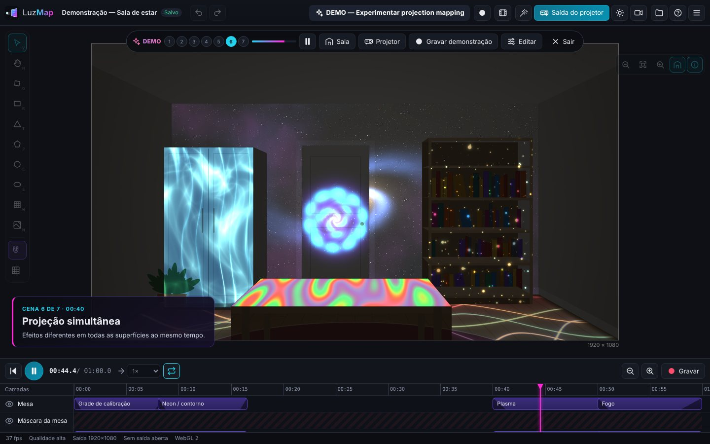
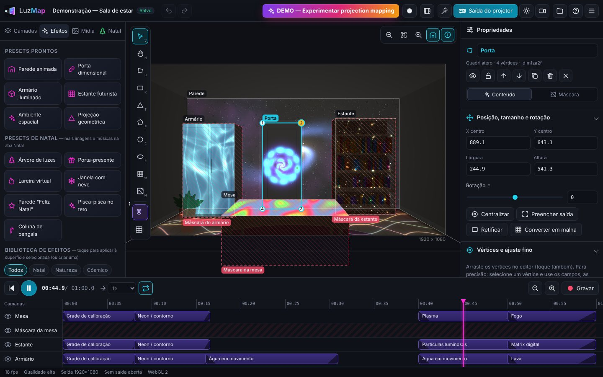
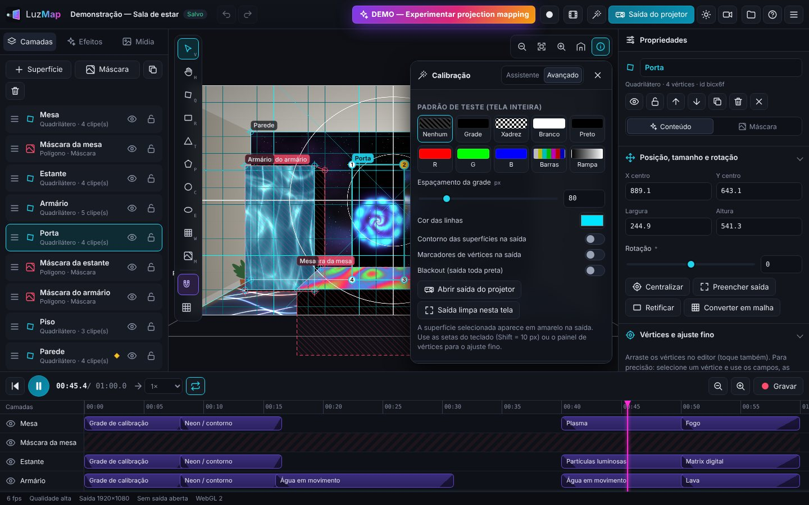
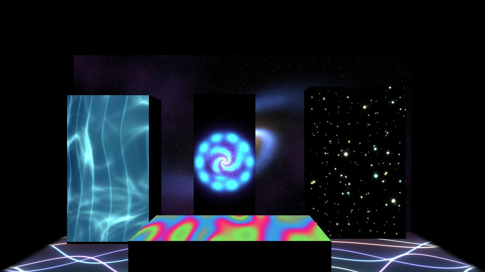
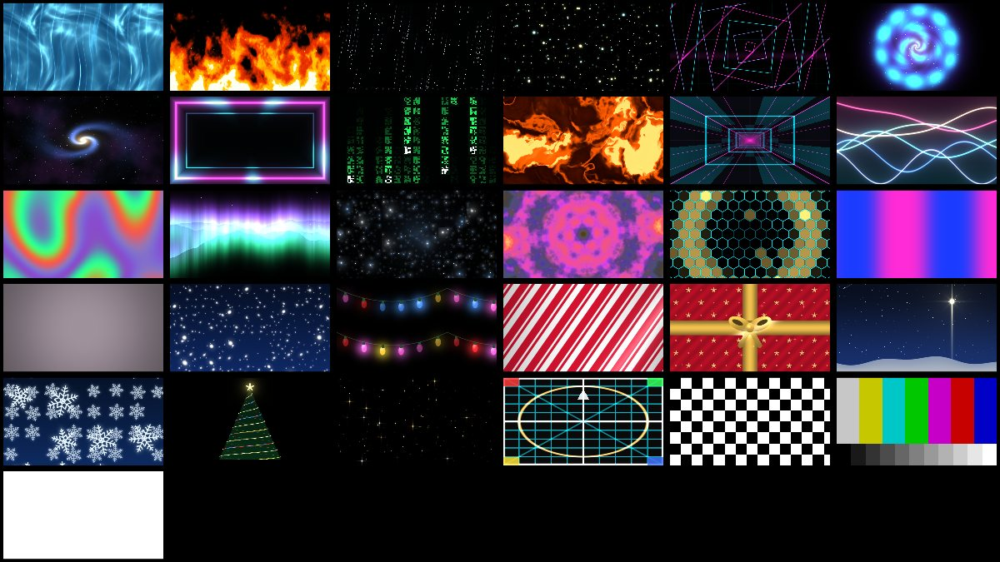
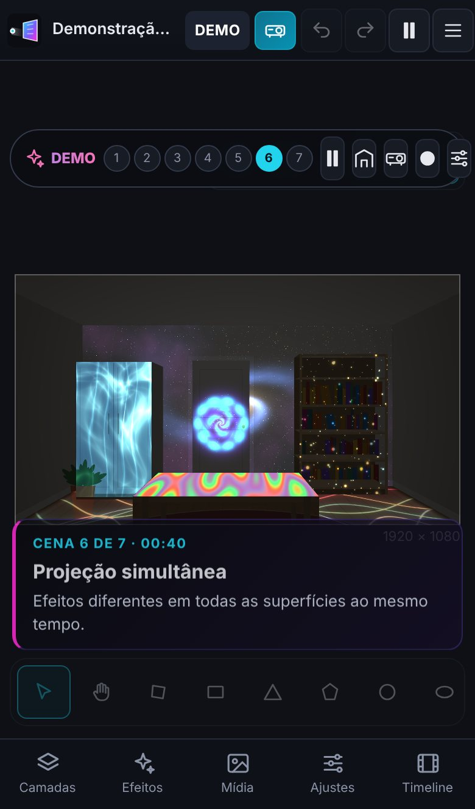
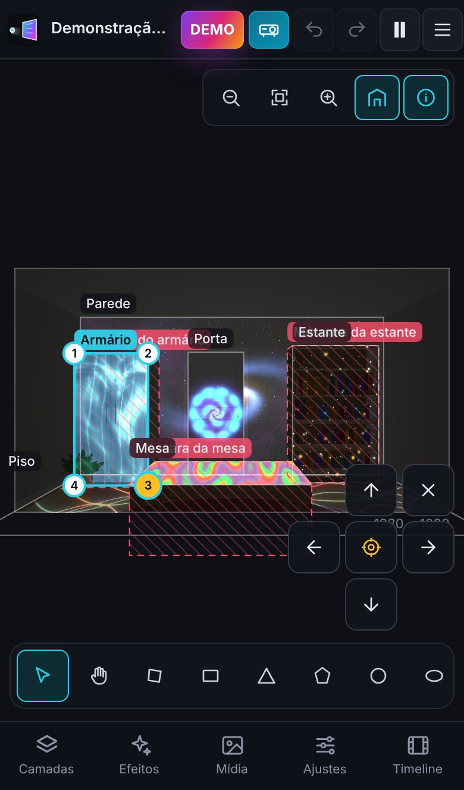
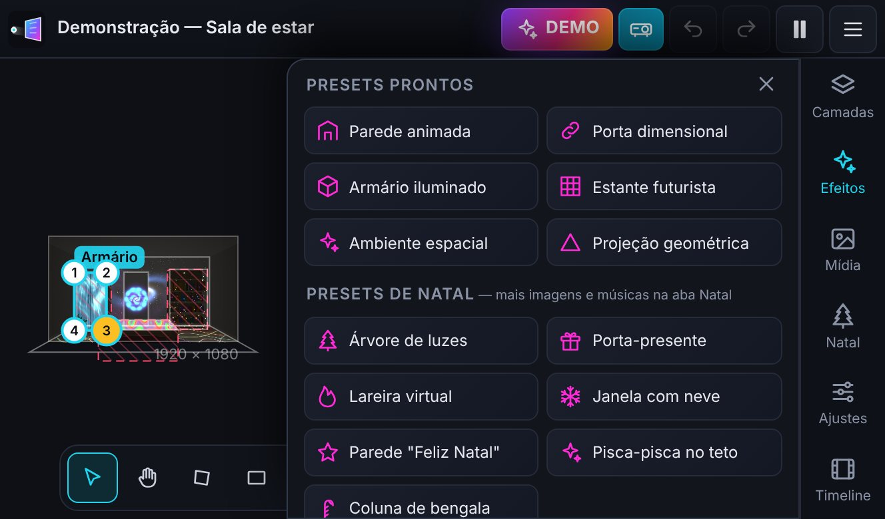

# LuzMap — Projection Mapping no navegador

Plataforma **gratuita** de *projection mapping* que roda inteira no navegador (HTML5 + CSS3 + JavaScript + WebGL), publicada como site estático no **GitHub Pages**. Transforme paredes, portas, armários, estantes, mesas e objetos em superfícies animadas — no **computador** ou no **celular**, sem cadastro, sem servidor e sem enviar seus arquivos para lugar nenhum.

> **Endereço (após ativar o GitHub Pages):** https://brunoalmeida87.github.io/ProjectionMapping/
> Veja [Publicação no GitHub Pages](#publicação-no-github-pages) — o deploy depende de um ajuste único nas configurações do repositório.



**▶ Vídeo de demonstração real (77 s):** [`demos/luzmap-demo.mp4`](demos/luzmap-demo.mp4) · [WebM](demos/luzmap-demo.webm) — também disponível no próprio site pelo botão **“Assistir demonstração”**.

---

## Sumário

- [Principais funcionalidades](#principais-funcionalidades)
- [Capturas de tela](#capturas-de-tela)
- [Como usar (5 minutos)](#como-usar-5-minutos)
- [Como conectar um projetor (Formovie S5 / HDMI)](#como-conectar-um-projetor-formovie-s5--hdmi)
- [Como usar no celular](#como-usar-no-celular)
- [Atalhos de teclado](#atalhos-de-teclado)
- [Publicação no GitHub Pages](#publicação-no-github-pages)
- [Navegadores compatíveis](#navegadores-compatíveis)
- [Limitações conhecidas](#limitações-conhecidas)
- [Arquitetura e código](#arquitetura-e-código)
- [Testes realizados](#testes-realizados)
- [Gerar o vídeo de demonstração](#gerar-o-vídeo-de-demonstração)
- [Privacidade e licença](#privacidade-e-licença)

---

## Principais funcionalidades

**Editor de mapping**
- Ferramentas: **retângulo, quadrilátero livre, triângulo, polígono, círculo, elipse, malha deformável (warp para superfícies curvas/irregulares) e máscara**.
- **Correção de perspectiva real por homografia** (não é `transform` CSS): o conteúdo é mapeado com interpolação projetiva exata na GPU — basta posicionar os 4 cantos sobre a porta, a parede ou o móvel.
- Cada superfície tem nome, identificador, posição, dimensões, vértices editáveis, rotação, opacidade, ordem de camada, conteúdo, visibilidade e bloqueio. Duplicar, excluir e reordenar (arrastar na lista).
- Edição precisa: campos numéricos por vértice (em pixels da saída), setas do teclado (Shift = 10 px, Alt = ¼ px), pad de ajuste fino com passo 1/5/20 px, **ímã** (encaixe em vértices e bordas), **lupa** ao arrastar com o dedo, grade do editor.
- Polígonos: adicionar pontos (botão “+” no meio das arestas, duplo clique ou painel) e remover pontos.
- **Máscaras** pintam de preto tudo o que estiver abaixo delas (ou, invertidas, tudo fora delas), com borda suave.
- Desfazer/refazer (Ctrl+Z / Ctrl+Shift+Z e botões na tela), histórico de 120 passos.

**Conteúdo**
- **23 efeitos gerados na GPU (GLSL)**, com miniaturas animadas e parâmetros (velocidade, cores, intensidade, escala, direção, densidade, frequência, amplitude):
  água em movimento, fogo, chuva, partículas luminosas, linhas geométricas, portal espacial, galáxia, neon/contorno, matrix digital, lava, ilusão 3D (túnel), ondas coloridas, plasma, aurora, viagem estelar, caleidoscópio, colmeia hexagonal, gradiente, pulso/estrobo + padrões de calibração (grade com cantos coloridos, xadrez, barras de cor, cor sólida).
- **6 presets**: Parede animada, Porta dimensional, Armário iluminado, Estante futurista, Ambiente espacial, Projeção geométrica.
- **Importação de mídia**: JPG, PNG, WebP, GIF (animado onde há `ImageDecoder`), MP4, WebM e demais formatos que o navegador decodifica; áudio (MP3, WAV, M4A…) como trilha sonora. Enquadramento cobrir/conter/esticar, zoom, deslocamento, rotação, espelhamento, repetição, reprodução/pausa, loop, velocidade, volume.
- Ajustes de cor por superfície: opacidade, mistura (normal/adicionar/tela/multiplicar), borda suave, brilho, contraste, saturação, matiz.
- **Áudio reativo** (microfone ou trilha sonora).

**Timeline**
- Reproduzir, pausar, reiniciar, velocidade (0,25× a 4×), loop, duração, zoom; arrastar a agulha com mouse ou dedo.
- **Clipes** por superfície (trocar conteúdo no tempo, fade de entrada/saída, transição cruzada ao sobrepor), ativar/desativar camadas.
- **Keyframes** de posição X/Y, escala, rotação, opacidade e intensidade do efeito, com interpolação suave.

**Saída para projetores**
- **Janela de projeção** (`output.html`) só com a composição final: fundo preto, sem menus, sem alças, sem grade. Sincronizada com o editor por `BroadcastChannel` (latência medida nos testes: 80–150 ms entre janelas, em renderização por software com a CPU compartilhada), com tela cheia (F / duplo clique), *Wake Lock* e ajuste “manter proporção / esticar”.
- Em Chrome/Edge, com a **Window Management API**, a saída é aberta já posicionada na segunda tela (projetor).
- **Saída limpa na mesma tela** para celulares/tablets (espelhamento, USB-C→HDMI, AirPlay/Miracast).
- **Presentation API** (experimental) para segundas telas sem fio, quando o navegador oferece.
- **Blackout** instantâneo.

**Calibração**
- Grade quadriculada, linhas de referência, círculos, diagonais, bordas, padrões **branco, preto, R, G, B, barras e rampa**, contorno luminoso de cada superfície e **marcadores de vértices** projetados (a superfície selecionada aparece em amarelo no projetor), resolução de saída configurável.
- **Assistente guiado em 6 passos** (resolução → grade → superfície → cantos → conteúdo de teste → salvar) e modo avançado.

**Projetos**
- Salvamento automático e manual no **IndexedDB** (projetos e mídias ficam no dispositivo), recuperação da sessão anterior, lista de projetos com miniaturas: abrir, renomear, duplicar, excluir, **exportar/importar JSON** (opcionalmente com as mídias embutidas). Quando uma mídia não existe no dispositivo, o app avisa que é preciso importá-la novamente. Uso do armazenamento exibido e erros de cota tratados.

**Demonstração e vídeo**
- Botão **DEMO — EXPERIMENTAR PROJECTION MAPPING**: sala residencial modelada em 3D simplificado (parede, porta, armário, estante, mesa e piso, em perspectiva real) mapeada com as mesmas ferramentas do usuário, em **7 cenas**: calibração → mapping geométrico → água no armário → portal na porta → galáxia na parede (com máscaras) → projeção simultânea → finalização. Modo “Sala” (simulação da luz sobre o ambiente) ou “Saída” (o que o projetor recebe).
- Botão **GRAVAR DEMONSTRAÇÃO** e gravador geral (`canvas.captureStream()` + `MediaRecorder`): resolução, FPS, qualidade, duração, áudio; só os formatos que o navegador realmente suporta (MP4 quando há suporte real, senão WebM). No computador também é possível gravar a tela com a interface.

**Desempenho e compatibilidade**
- Renderização 100% GPU (WebGL 2 com fallback WebGL 1), renderização sob demanda (para quando nada muda), perfis de qualidade **baixa/média/alta** com detecção automática e redução adaptativa se o FPS cair, controle de resolução, recuperação de perda de contexto WebGL, descarte de texturas ociosas.
- **PWA** instalável com uso offline do app após o primeiro carregamento (service worker; mídias externas não são garantidas offline).
- Detecção de recursos com mensagens objetivas (ajuda → “Recursos deste navegador”).
- Interface em português, tema escuro, responsiva de verdade: no celular, barra de abas inferior, painéis deslizantes, ferramentas grandes, pinça para zoom, layout próprio em paisagem.

## Capturas de tela

| Editor (desktop) | Calibração |
|---|---|
|  |  |
| **Saída do projetor (janela limpa)** | **Biblioteca de efeitos (todos gerados na GPU)** |
|  |  |

| Celular — demo | Celular — edição com ajuste fino | Celular — paisagem |
|---|---|---|
|  |  |  |

## Como usar (5 minutos)

1. Abra o site e clique em **DEMO — Experimentar projection mapping** para ver o que é possível (ou **Assistir demonstração** para o vídeo).
2. Para o seu ambiente: **Calibrar → Assistente** e escolha a resolução do projetor (1920 × 1080 para o Formovie S5).
3. Abra a **Saída do projetor** e coloque-a em tela cheia no projetor.
4. Ferramenta **Quadrilátero** (tecla Q): toque/clique nos 4 cantos do objeto real (porta, frente do armário…). Ajuste cada vértice olhando para a parede — a grade de teste ajuda a conferir a perspectiva (o quadrado vermelho é o canto superior esquerdo).
5. Escolha um efeito na aba **Efeitos** (ou importe imagem/vídeo na aba **Mídia**) — com uma superfície selecionada basta um clique.
6. Repita para outras superfícies. Use **Máscara** (tecla M) para não projetar onde não deve (parede vizinha, quadros, TV…).
7. Opcional: anime com **clipes** e **keyframes** na timeline.
8. O projeto é salvo automaticamente; exporte em JSON para levar a outro dispositivo.

> Dica: tire uma foto do ambiente a partir da posição do projetor e use-a como **foto de referência** (aba Mídia → ícone de casa). Com o botão **Simulação** você vê a luz projetada sobre a foto antes mesmo de ligar o projetor.

## Como conectar um projetor (Formovie S5 / HDMI)

Fluxo recomendado no **Windows** com **Chrome ou Edge**:

1. Acesse o LuzMap pelo endereço do GitHub Pages e crie/abra um projeto.
2. Conecte o Formovie S5 ao computador por **HDMI**.
3. Pressione **Win + P** e escolha **Estender** (a área de trabalho passa a ter duas telas).
4. No LuzMap, clique em **Saída do projetor → Abrir janela do projetor** (ou tecla **O**). Em Chrome/Edge você pode usar **“Detectar o projetor e abrir nele”**: o navegador pede permissão de gerenciamento de janelas e já posiciona a saída na segunda tela.
5. Se a janela abrir na tela errada, arraste-a para a tela do projetor.
6. Clique na janela e pressione **F** (ou dê duplo clique) para **tela cheia**.
7. Continue editando na tela do computador — as alterações aparecem na projeção em tempo real.

Notas: o navegador exige um clique para abrir janelas e entrar em tela cheia (restrição de segurança). Se o pop-up for bloqueado, permita pop-ups para o site ou use **Saída limpa nesta tela**. No macOS o fluxo é o mesmo (Ajustes → Monitores → usar como monitor estendido).

## Como usar no celular

- O editor completo funciona por toque: **toque** seleciona, **arraste** move superfícies e vértices (com lupa de precisão), **dois dedos** fazem zoom/deslocamento sem alterar a geometria, o **pad de setas** faz ajuste fino de 1/5/20 px, e há botões de desfazer/refazer no topo.
- Painéis: **Camadas, Efeitos, Mídia, Ajustes e Timeline** na barra inferior (em paisagem, na lateral).
- Para projetar: conecte o projetor (adaptador **USB-C → HDMI**, espelhamento **Miracast/Smart View/AirPlay**) e toque em **Saída do projetor → Saída limpa nesta tela**: só a composição aparece, em tela cheia quando o navegador permite.
- **Limitação real da plataforma:** navegadores de celular não permitem controlar duas telas de forma independente; o celular espelha o que está na própria tela. Por isso a “saída limpa” é o caminho compatível.
- **iPhone/iPad:** o Safari não oferece tela cheia para páginas (só para vídeos). Para ocupar a tela toda, use Compartilhar → **Adicionar à Tela de Início** e abra o LuzMap pelo ícone.

## Atalhos de teclado

| Tecla | Ação |
|---|---|
| V / H | Selecionar / mover a vista (ou Espaço + arrastar, botão do meio) |
| Q R T P C E W M | Quadrilátero, retângulo, triângulo, polígono, círculo, elipse, malha, máscara |
| Roda do mouse, pinça | Zoom · `0` enquadra · `+`/`-` |
| Setas | Move vértice/superfície 1 px (Shift = 10 px, Alt = ¼ px) |
| Tab / Shift+Tab | Próximo / anterior vértice |
| Delete | Exclui vértice de polígono, clipe, keyframe ou superfície |
| Ctrl+Z / Ctrl+Shift+Z (Ctrl+Y) | Desfazer / refazer |
| Ctrl+D · Ctrl+S · Ctrl+O | Duplicar · salvar · projetos |
| Espaço · Home | Reproduzir/pausar · voltar ao início |
| `[` `]` | Descer / subir camada |
| G · S · L | Grade · ímã · nomes |
| O · F · B | Janela do projetor · saída limpa · blackout |
| Enter / Esc | Concluir / cancelar desenho, desselecionar |

## Publicação no GitHub Pages

O projeto **não tem etapa de build**: a raiz do repositório é o site. Todos os caminhos são relativos, então funciona em `https://usuario.github.io/nome-do-repositorio/`.

**Opção A — GitHub Actions (já incluída):**
1. No repositório: **Settings → Pages → Build and deployment → Source: GitHub Actions**.
2. Faça merge na branch `main` (ou rode o workflow manualmente em **Actions → Publicar no GitHub Pages → Run workflow**).
3. O workflow [`.github/workflows/pages.yml`](.github/workflows/pages.yml) roda os testes de geometria e publica apenas os arquivos públicos.

**Opção B — direto da branch:**
1. **Settings → Pages → Source: Deploy from a branch**, branch `main` (ou a branch desejada), pasta **`/ (root)`**.
2. O arquivo `.nojekyll` já está na raiz.

Depois de publicado, acesse `https://brunoalmeida87.github.io/ProjectionMapping/`. Requisitos atendidos: HTTPS (exigido por microfone, service worker, Wake Lock e Window Management), nenhum backend, nenhuma rota que dependa de reescrita do servidor, nenhuma dependência de CDN (zero bibliotecas externas: o motor WebGL é próprio).

**Testar localmente:** abrir `index.html` direto do disco (`file://`) não funciona porque os navegadores bloqueiam módulos ES nesse modo (o app mostra um aviso). Use qualquer servidor estático, por exemplo `node tools/serve.mjs` (só para desenvolvimento) e acesse `http://localhost:8080/`.

## Navegadores compatíveis

| Recurso | Chrome / Edge (Win, macOS, Android) | Firefox | Safari macOS | Safari iOS/iPadOS |
|---|---|---|---|---|
| Editor + WebGL + efeitos | ✅ | ✅ | ✅ | ✅ (iOS 15+) |
| Janela do projetor sincronizada | ✅ | ✅ | ✅ (15.4+) | — (use saída limpa + espelhamento) |
| Posicionar saída na 2ª tela automaticamente | ✅ (Window Management API) | ❌ arraste manual | ❌ arraste manual | — |
| Tela cheia | ✅ | ✅ | ✅ | iPad ✅ · iPhone: via “Adicionar à Tela de Início” |
| Gravação de vídeo | ✅ WebM; MP4 nas versões recentes | ✅ WebM | ✅ MP4 | ✅ MP4 (versões recentes) |
| GIF animado | ✅ | ✅ (versões com ImageDecoder) | ✅ 17+ | ✅ 17+ |
| Áudio reativo (microfone) | ✅ | ✅ | ✅ | ✅ |
| Wake Lock | ✅ | ✅ (recente) | ✅ (16.4+) | ✅ (16.4+) |

Prioridade de uso com projetor HDMI: **Windows + Chrome/Edge**. A tabela reflete as capacidades das plataformas; veja em [Testes realizados](#testes-realizados) o que foi efetivamente executado.

## Limitações conhecidas

- **Celulares não controlam duas telas independentes** pelo navegador: usa-se espelhamento + saída limpa. A Presentation API depende do navegador e do receptor (experimental).
- **Abrir janela e entrar em tela cheia exigem um clique** do usuário (regra dos navegadores).
- **iPhone:** sem tela cheia para páginas no Safari (use a instalação na Tela de Início).
- **GIF animado** depende de `ImageDecoder`; sem ele o GIF aparece como imagem estática (o app informa).
- **Formatos de vídeo** dependem do navegador (MP4 H.264 e WebM cobrem praticamente todos). Vídeos 4K podem ser pesados em celulares.
- **WebM gravado pelo Chrome** pode não exibir a duração em alguns players (reproduz normalmente).
- **Mídias são locais**: projetos exportados sem “com mídias” guardam só a referência; em outro dispositivo é preciso reimportar os arquivos (o app avisa). O espaço do IndexedDB depende do navegador.
- Calibração é **manual** (sem câmera/sensores), como solicitado.
- A latência entre editor e janela do projetor depende do sistema; o vídeo de cada janela é decodificado separadamente e ressincronizado se desviar mais de ~0,35 s.

## Arquitetura e código

Sem frameworks e sem dependências: **~10 mil linhas** de JavaScript moderno (módulos ES), GLSL ES 1.00 (compatível com WebGL 1 e 2) e CSS.

```
index.html            editor (desktop + celular)
output.html           saída do projetor (só a composição)
manifest.webmanifest  PWA            sw.js  service worker (cache do app)
css/style.css         tema escuro, grid desktop, bottom sheets no celular
shaders/common.js     pipeline das superfícies: homografia, máscara, feather, cor
shaders/effects.js    23 efeitos GLSL
js/app.js             inicialização, ações, atalhos, autosave, modais
js/mapping.js         homografia (quadrado→quad, DLT), triangulação, malha, contornos
js/renderer.js        compositor WebGL (stencil p/ máscaras invertidas, FBO p/ simulação)
js/gl.js              utilitários WebGL
js/editor.js          interação: ferramentas, vértices, gestos, ímã, lupa, overlay
js/state.js           modelo do projeto, clipes, keyframes, desfazer/refazer
js/effects.js         catálogo e parâmetros dos efeitos
js/media.js           importação, vídeo/GIF/áudio, sincronização com a timeline
js/storage.js         IndexedDB (projetos, mídias) + preferências (localStorage)
js/inspector.js       painel de propriedades       js/panels.js   camadas, efeitos, mídia
js/timeline.js        timeline (clipes, keyframes) js/transport.js relógio
js/projector.js       janelas de saída, Window Management, Presentation API
js/sync.js            protocolo BroadcastChannel / postMessage / PresentationConnection
js/output.js          lógica da página de saída
js/calibration.js     padrões e assistente        js/recorder.js  MediaRecorder
js/demo.js + room.js  demo residencial (sala 3D projetada em perspectiva)
js/audio.js           áudio reativo                js/presets.js  presets
js/capabilities.js    detecção de recursos e perfil de qualidade
demos/                vídeo de demonstração + projeto de exemplo (JSON)
tests/                testes de unidade (Node) e E2E (Playwright)
tools/                servidor local, gerador de vídeo, capturas e ícones (só desenvolvimento)
```

**Como a perspectiva é feita:** para cada quadrilátero calcula-se a homografia *H* que leva o quadrado unitário de textura aos 4 cantos na saída. Cada vértice recebe `(U,V,W) = H⁻¹·(x,y,1)`, que é **linear no espaço da tela**; a GPU interpola linearmente e o fragment shader divide `U/W, V/W`, reproduzindo exatamente a projeção (o teste E2E confirma que o centro da textura cai no cruzamento das diagonais, o que uma interpolação bilinear não faz). Malhas usam uma homografia por célula; triângulos usam mapeamento afim; polígonos usam projeção planar com triangulação *ear clipping*.

## Testes realizados

Executados neste ambiente de desenvolvimento (Linux, Chromium do Playwright em modo *headless* com renderização por software SwiftShader):

- **Unidade (Node `node --test`)** — 10/10: homografia vs. solução geral (DLT), inversa, ponto central = cruzamento das diagonais, interpolação (U,V,W) exata, triangulação de polígono côncavo, ordenação de cantos, malha, transformações.
- **E2E (`node tests/e2e.mjs`)** — **51/51**, com o site servido em sub-caminho `/ProjectionMapping/` (como no GitHub Pages):
  - Desktop 1440×900 (mouse/teclado): carrega sem erros nem 404; caminhos relativos; cria as 8 ferramentas de forma; arrasta vértice sem mover os demais; ajuste fino por setas; desfazer/refazer; **perspectiva verificada por pixels** (cantos coloridos e centro projetivo); **máscaras** normal e invertida verificadas por pixels; efeitos animando e 4 superfícies simultâneas; 23 shaders compilam; **importa PNG** (cores verificadas), **WebM** (reproduz em loop), **MP4 H.264** (reproduziu neste Chromium), **GIF** (animado via ImageDecoder); **salva no IndexedDB e recupera após recarregar**; exporta/importa JSON; aviso de mídia ausente; **janela do projetor** abre, sincroniza (latência medida 80–150 ms) e não contém interface; saída limpa; assistente de calibração com 6 passos; **demo** com as 7 cenas e ≥6 superfícies simultâneas; **gravação MediaRecorder** gerou arquivo; restauração do projeto ao sair da demo; console sem erros críticos.
  - **PWA**: service worker ativo e o app abre **offline** após o primeiro acesso.
  - Layout em **notebook 1366×768**, **monitor Full HD 1920×1080**, **iPad Pro 11** (vertical e horizontal) e **Galaxy Tab S4**: sem rolagem/sobreposição, controles principais visíveis.
  - Emulação de **iPhone 13 (vertical e horizontal)** e **Pixel 7** com toque: sem rolagem horizontal, controles visíveis, toque seleciona, **arrasto de vértice com o dedo**, **pinça faz zoom sem alterar a geometria**, painéis deslizantes, demo, saída limpa com aviso de limitações, console sem erros.
  - Resultado detalhado em `tests/results/e2e-results.json`.

**Não testado aqui (sem acesso ao hardware/navegadores):** aparelhos físicos Android/iPhone/tablets, motores Safari (WebKit) e Firefox (Gecko) reais, GPUs reais, monitores Full HD físicos, o projetor Formovie S5 e conexões HDMI/espelhamento, Window Management e Presentation API com telas reais, áudio por microfone. A emulação de dispositivos do Chromium valida layout e toque, mas não substitui esses testes — recomenda-se conferir no seu equipamento.

Rodar os testes: `node --test tests/mapping.test.mjs` e `node tests/e2e.mjs` (requer Playwright + Chromium e ffmpeg para gerar as mídias de teste).

## Gerar o vídeo de demonstração

O vídeo em `demos/` é uma captura real do aplicativo, gerada por `node tools/make-demo-video.mjs`: o script abre o app no Chromium, executa o roteiro (interface → criar superfície → ajustar vértices → aplicar efeito → perspectiva → várias superfícies → saída limpa → demo residencial) usando um **relógio determinístico** (o app avança exatamente 1/30 s por quadro, então o vídeo fica fluido mesmo com renderização por software) e codifica MP4 (H.264) e WebM (VP9) com o ffmpeg.

Sem ferramentas de desenvolvimento, você pode gerar o seu pelo próprio site:
- **GRAVAR DEMONSTRAÇÃO** grava os 60 s da demo automática (simulação da sala) e baixa o arquivo;
- **Gravar vídeo** grava qualquer projeto (saída limpa ou simulação), com resolução/FPS/qualidade/duração;
- **Gravar a tela (com interface)** (computador) usa `getDisplayMedia` para incluir o editor no vídeo.

## Privacidade e licença

Tudo roda no seu navegador. Projetos e mídias ficam no **IndexedDB do seu dispositivo**; nada é enviado a servidores, não há cadastro, rastreamento ou anúncios. Código sob licença **MIT** ([LICENSE](LICENSE)).
