# Manual do LuzMap

**Projection mapping no navegador, explicado do zero.**

Este manual ensina a usar cada parte do LuzMap e mostra como o sistema funciona por dentro. Ele foi escrito para quem nunca fez *projection mapping*: os conceitos aparecem antes dos botões, e cada recurso vem com o que ele faz, quando usar e como usar.

- **Endereço do aplicativo:** https://brunoalmeida87.github.io/ProjectionMapping/
- **Vídeo de demonstração:** botão **Assistir demonstração** no próprio site ou `demos/luzmap-demo.mp4` no repositório.
- **Versão do manual:** 1.0 — novembro de 2026.

> [!TIP]
> **Como ler este manual.** Se você tem pressa, leia a Parte 1 (conceitos) e faça o tutorial do capítulo 6. Depois consulte os outros capítulos quando precisar. A Parte 4 é para quem quer entender o código; não é necessária para usar o sistema.

---

# Parte 1 — Entendendo o projection mapping

## 1. O que é projection mapping

Um projetor comum joga um retângulo de luz na parede. Se você apontar para uma porta, um armário ou uma estante, a imagem não “encaixa” no objeto: ela fica torta (porque o projetor quase nunca está exatamente de frente), sai das bordas e cai na parede ao lado.

**Projection mapping** é a técnica de pré-distorcer a imagem no computador para que, depois de projetada, ela caia exatamente sobre o objeto real. Você diz ao programa “os quatro cantos da porta estão aqui, aqui, aqui e aqui” e ele entorta a imagem até que a luz preencha a porta e nada mais. Com várias superfícies mapeadas, cada objeto da sala ganha o seu próprio conteúdo: água escorrendo no armário, um portal na porta, uma galáxia na parede.

Três ideias resumem tudo:

1. **O projetor é uma lanterna que pinta com luz.** Onde a imagem é preta, não há luz — o objeto fica escuro. Por isso o fundo da projeção é sempre preto.
2. **O mapeamento é feito no ponto de vista do projetor.** O que importa é onde cada canto do objeto aparece *na imagem que sai do projetor*, não as medidas reais do objeto.
3. **A calibração é visual.** Você olha para a parede, arrasta os cantos no editor e vê a projeção se ajustar ao vivo, até encaixar.

## 2. Como o LuzMap funciona, em uma figura

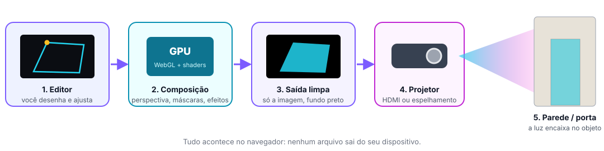

*Figura 1 — Do editor à parede.*

1. **Editor:** você desenha superfícies sobre a área de projeção e escolhe o conteúdo de cada uma.
2. **Composição:** a placa de vídeo (GPU) do seu computador ou celular distorce cada conteúdo com perspectiva correta, aplica máscaras e gera os efeitos animados em tempo real.
3. **Saída limpa:** uma janela (ou a própria tela, no celular) mostra só a imagem final, em fundo preto, sem botões.
4. **Projetor:** recebe essa janela pelo cabo HDMI (ou por espelhamento de tela).
5. **Parede e objetos:** a luz cai exatamente onde você posicionou cada superfície.

Tudo roda no navegador. Não há servidor, cadastro ou envio de arquivos: projetos, fotos e vídeos ficam guardados no seu próprio dispositivo.

## 3. Conceitos-chave

| Termo | O que significa no LuzMap |
|---|---|
| **Saída** | A imagem que vai para o projetor. Tem uma **resolução** (ex.: 1920 × 1080), que deve ser a do projetor. |
| **Palco** | O retângulo escuro no centro do editor: é a área da saída. Tudo fora dele não é projetado. |
| **Superfície** | Uma forma desenhada sobre o palco (quadrilátero, triângulo, polígono, círculo…) que corresponde a um objeto real e recebe um conteúdo. |
| **Vértice** | Um canto da superfície. Arrastar vértices é como você encaixa a superfície no objeto. |
| **Perspectiva / homografia** | A distorção matemática que faz um conteúdo retangular ocupar um quadrilátero qualquer como se estivesse “de verdade” naquele plano. |
| **Conteúdo** | O que aparece dentro da superfície: um **efeito** gerado pelo computador, uma **mídia** (imagem, GIF ou vídeo) ou nada. |
| **Efeito** | Animação gerada em tempo real pela GPU (água, fogo, galáxia…), com parâmetros como cor e velocidade. |
| **Máscara** | Uma superfície especial que pinta de preto (sem luz) tudo o que está abaixo dela. Serve para não projetar onde não deve. |
| **Camada** | A ordem das superfícies. A de cima é desenhada por último e cobre as de baixo. |
| **Timeline** | A linha do tempo do projeto: tocar, pausar, trocar conteúdos com **clipes** e animar propriedades com **keyframes**. |
| **Calibração** | Projetar grades e padrões de teste para alinhar as superfícies com os objetos reais. |
| **Simulação** | Ver no editor como a luz projetada ficaria sobre uma foto do ambiente, antes de ligar o projetor. |

---

# Parte 2 — Primeiros passos

## 4. Abrindo o LuzMap

Acesse **https://brunoalmeida87.github.io/ProjectionMapping/** em um navegador atualizado (Chrome, Edge, Firefox ou Safari). Não é preciso instalar nada nem criar conta.

Na primeira visita aparece a janela de boas-vindas:

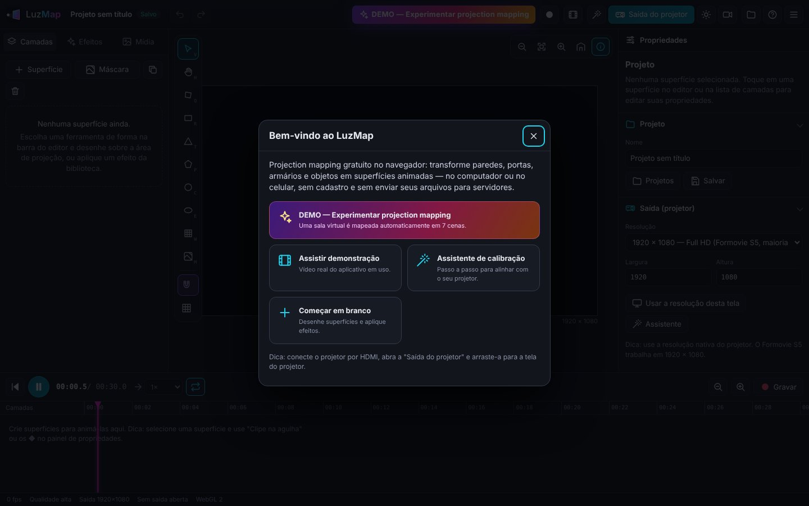

*Figura 2 — Boas-vindas.*

- **DEMO — Experimentar projection mapping:** abre uma sala virtual já mapeada e mostra os recursos em 7 cenas (capítulo 21). É a melhor forma de começar.
- **Assistir demonstração:** vídeo do aplicativo em uso.
- **Assistente de calibração:** passo a passo para alinhar com o seu projetor (capítulo 16).
- **Começar em branco:** fecha a janela e deixa você no editor vazio.

> [!NOTE]
> Nas próximas visitas o LuzMap reabre automaticamente o último projeto e mostra o aviso “Sessão anterior restaurada”. Para começar outro, use o botão **Novo projeto** desse aviso ou o menu.

**Requisitos:** um navegador com WebGL (praticamente todos os atuais). Para usar o microfone, a tela cheia e o modo offline, o site precisa ser aberto por **https** — o GitHub Pages já faz isso. Abrir o arquivo `index.html` direto do disco não funciona: o navegador bloqueia os módulos do programa nesse modo, e o LuzMap mostra um aviso explicando isso.

## 5. Tour pela interface (computador)

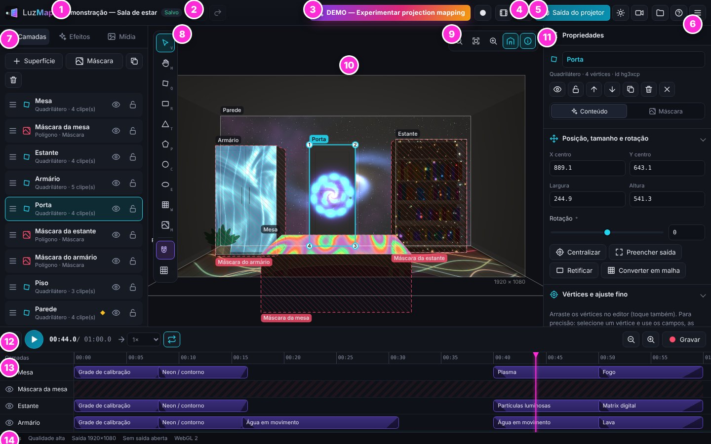

*Figura 3 — As regiões da tela. Os números correspondem à lista abaixo.*

1. **Nome do projeto e estado do salvamento.** Clique para abrir a lista de projetos. O selo ao lado mostra **Salvo**, **Alterações…** ou **Salvando…**.
2. **Desfazer / refazer** (Ctrl+Z / Ctrl+Shift+Z).
3. **DEMO — Experimentar projection mapping**, seguido de **Gravar demonstração** e **Assistir demonstração** (em telas menores, esses dois aparecem só como ícones; passe o mouse para ver o nome).
4. **Calibrar:** abre o painel de calibração e o assistente.
5. **Saída do projetor:** opções para mandar a imagem ao projetor. Ao lado ficam **Blackout** (sol), **Gravar vídeo**, **Projetos**, **Ajuda**.
6. **Menu:** todas as ações em uma lista (útil no celular).
7. **Abas do painel esquerdo:** **Camadas**, **Efeitos** e **Mídia**.
8. **Barra de ferramentas:** selecionar, mover a vista e as ferramentas de desenho (capítulo 8). Os dois botões de baixo ligam o **ímã** e a **grade**.
9. **Controles da vista:** afastar, enquadrar, aproximar, **Simulação** (casinha) e **nomes** das superfícies.
10. **Palco:** a área da saída. Aqui você desenha e ajusta as superfícies.
11. **Propriedades:** tudo sobre a superfície selecionada (ou sobre o projeto, se nada estiver selecionado).
12. **Transporte da timeline:** voltar ao início, tocar/pausar, tempo, velocidade, loop, zoom e **Gravar**.
13. **Trilhas da timeline:** uma linha por superfície, com clipes e keyframes.
14. **Barra de status:** quadros por segundo (fps), perfil de qualidade, resolução da saída, projetores conectados e versão do WebGL.

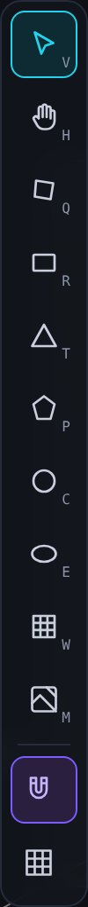

*Figura 4 — Barra de ferramentas. A letra pequena em cada botão é o atalho de teclado.*

## 6. Seu primeiro mapping (tutorial em 8 passos)

Neste tutorial você vai mapear uma porta. Para acompanhar sem projetor, use a **sala de demonstração** como foto de referência — o resultado é o mesmo que você teria olhando para a parede real.

**Passo 1 — Defina a resolução.** Com nada selecionado, o painel **Propriedades** mostra o projeto. Em **Saída (projetor) → Resolução**, escolha a resolução nativa do seu projetor. Para o Formovie S5 e a maioria dos projetores HDMI: **1920 × 1080**.

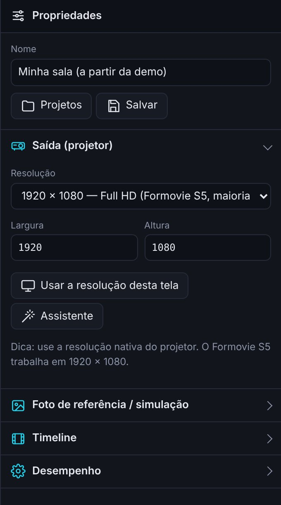

*Figura 5 — Propriedades do projeto (aparecem quando nenhuma superfície está selecionada).*

**Passo 2 — (Opcional) Foto de referência.** Em **Foto de referência / simulação → Imagem de fundo**, escolha **Sala de demonstração** (ou importe uma foto sua na aba **Mídia** e use o ícone de casinha). A foto aparece só no editor; ela nunca vai para o projetor.

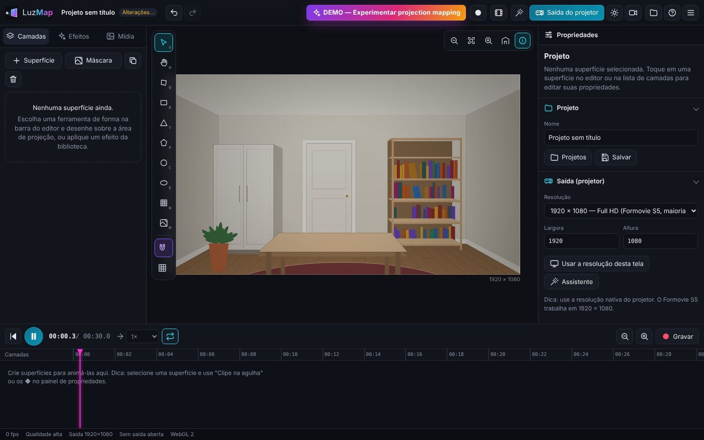

*Figura 6 — O palco com a foto de referência.*

**Passo 3 — Desenhe a superfície.** Clique na ferramenta **Quadrilátero** (tecla **Q**) e dê **um clique em cada canto** da porta, em qualquer ordem. Enquanto desenha, a barra inferior mostra quantos pontos faltam e oferece **Ponto** (desfazer o último), **Concluir** e **Cancelar**.

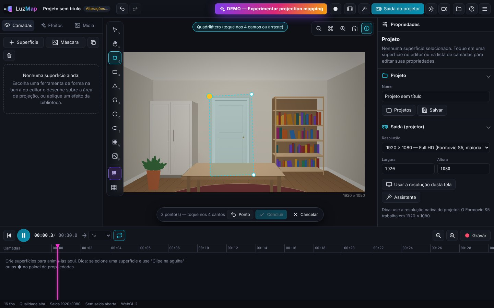

*Figura 7 — Marcando os cantos da porta.*

Ao marcar o quarto ponto, a superfície é criada com a **grade de calibração** dentro dela. Os quadrados coloridos nos cantos mostram a orientação: **vermelho = superior esquerdo**, verde = superior direito, azul = inferior direito, amarelo = inferior esquerdo. A seta branca aponta para cima.

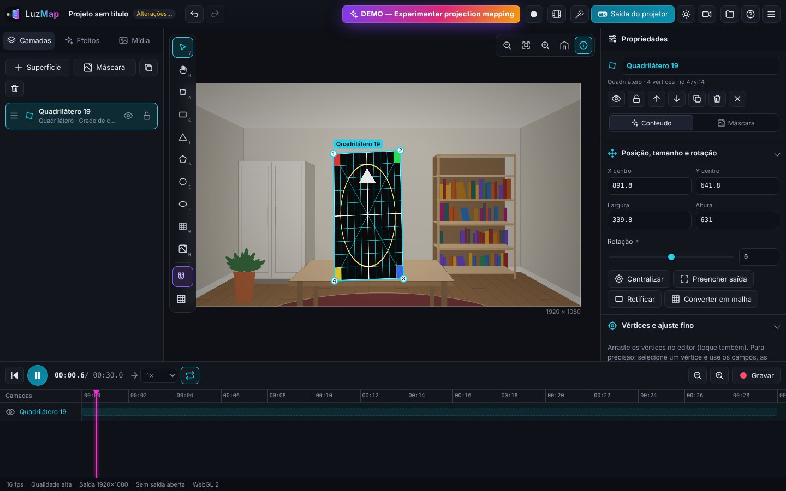

*Figura 8 — A superfície criada. Os cliques não precisam ser perfeitos: o ajuste vem a seguir.*

**Passo 4 — Ajuste os vértices.** Com a ferramenta **Selecionar** (tecla **V**), arraste cada círculo numerado até o canto exato da porta. Para precisão, clique num vértice (ele fica amarelo) e use as **setas do teclado** (1 pixel; com Shift, 10 pixels) ou os campos **X** e **Y** em **Propriedades → Vértices e ajuste fino**.

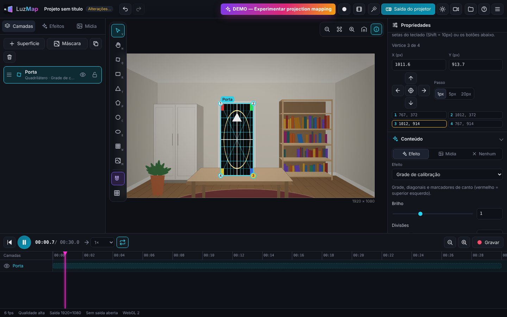

*Figura 9 — Ajuste fino: vértice 3 selecionado, coordenadas em pixels da saída e botões de setas.*

**Passo 5 — Aplique um efeito.** Abra a aba **Efeitos** e clique em **Portal espacial**. Pronto: o portal aparece dentro da porta, com a perspectiva correta.

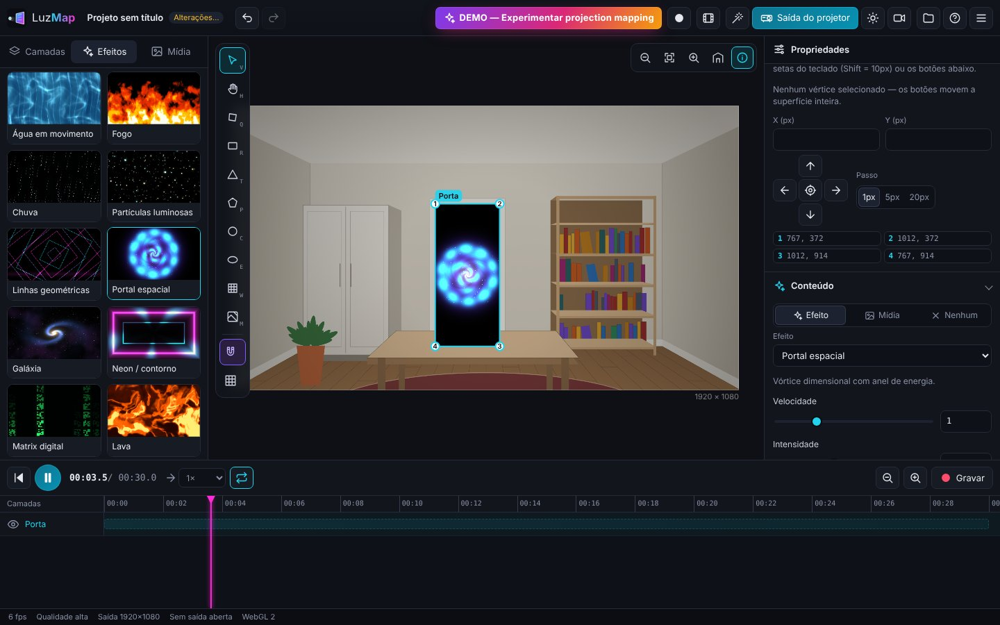

*Figura 10 — Efeito aplicado com um clique.*

**Passo 6 — Ajuste a aparência.** Em **Propriedades → Conteúdo**, mude velocidade, cores e intensidade. Em **Aparência e cor**, experimente **Borda suave** para esfumar as bordas.

**Passo 7 — Mande para o projetor.** Clique em **Saída do projetor → Abrir janela do projetor**, leve a janela para a tela do projetor e pressione **F** para tela cheia (capítulo 17).

**Passo 8 — Salve.** O projeto é salvo sozinho a cada alteração. Para garantir, use **Ctrl+S**. Para levar a outro aparelho, exporte em JSON (capítulo 19).

> [!TIP]
> Repita os passos 3 a 5 para cada objeto: um quadrilátero para a frente do armário, outro para a estante e assim por diante. Depois use máscaras (capítulo 14) para impedir que a luz da parede caia sobre os móveis.

## 7. Usando no celular e no tablet

No celular o LuzMap tem uma interface própria, pensada para o toque:

| Celular — camadas | Celular — propriedades |
|---|---|
| 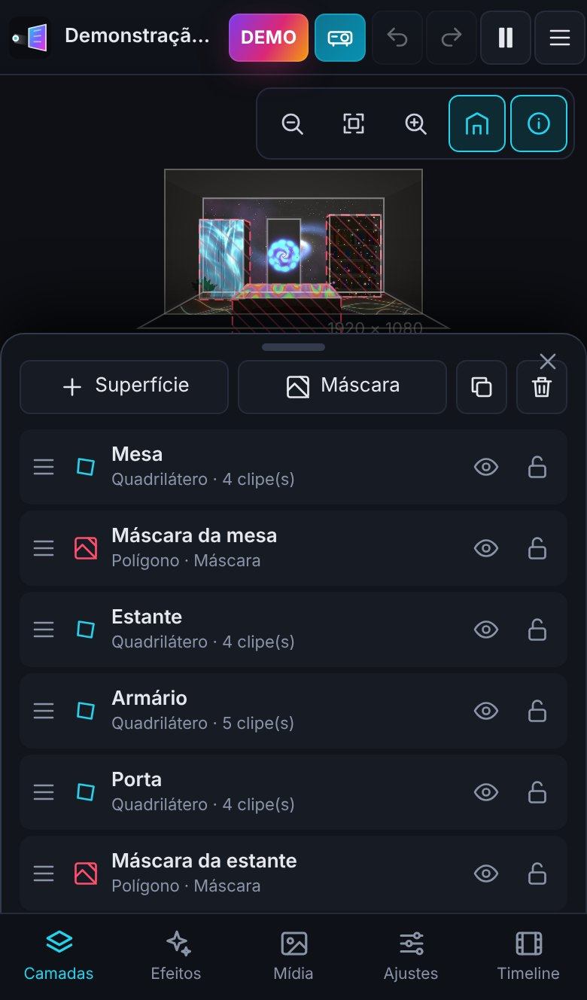 | 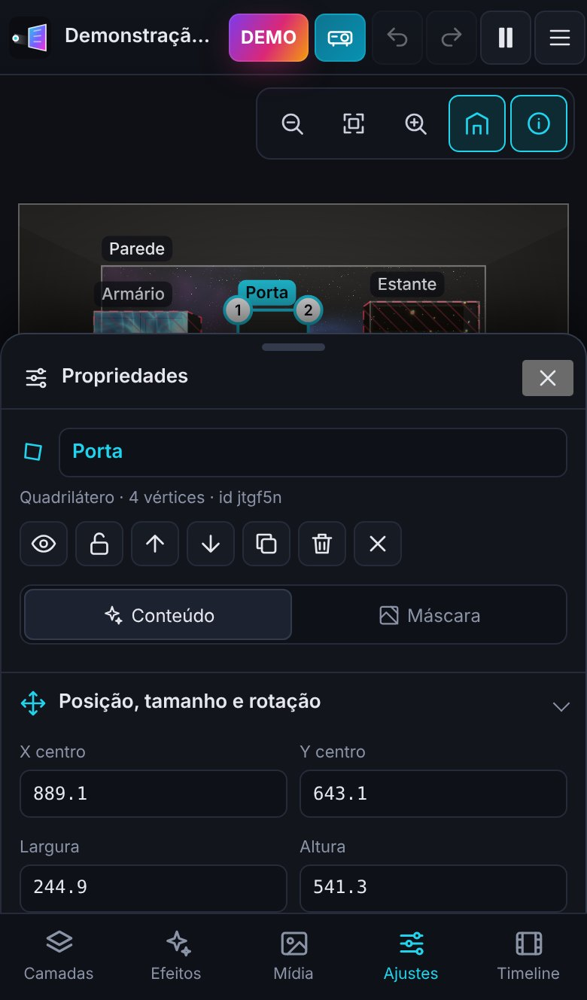 |

*Figura 11 — Os painéis sobem de baixo e o palco se ajusta para continuar visível.*

- **Barra inferior:** **Camadas, Efeitos, Mídia, Ajustes** (propriedades) e **Timeline**. Toque uma vez para abrir o painel e outra vez para fechar. Arraste a alça do painel para baixo para fechar ou para cima para expandir.
- **Barra superior:** menu, nome do projeto, **DEMO**, saída, desfazer, refazer e tocar/pausar.
- **Ferramentas:** ficam numa barra horizontal na parte de baixo do palco (deslize para ver todas).
- **Gestos:**
  - **um dedo** sobre uma superfície: seleciona e arrasta;
  - **um dedo** sobre um vértice: arrasta o vértice, com uma **lupa** que mostra a área ampliada (seu dedo não esconde o canto);
  - **um dedo** num espaço vazio: desloca a vista;
  - **dois dedos**: pinça para zoom e deslocamento. Os dois dedos nunca editam a geometria — se você começar a arrastar um vértice e encostar o segundo dedo, o arrasto é cancelado.
- **Ajuste fino:** ao selecionar um vértice aparece um **pad de setas** flutuante; o botão do meio passa para o próximo vértice.
- **Paisagem (celular deitado):** a barra de painéis vai para a lateral direita e os painéis deslizam do lado, deixando o palco maior.
- Tocar numa camada da lista abre direto o painel **Ajustes** daquela superfície.

Para projetar a partir do celular, veja o capítulo 17.

---

# Parte 3 — Cada parte em detalhe

## 8. Ferramentas de desenho

| Ferramenta (tecla) | Como desenhar | Quando usar |
|---|---|---|
| **Selecionar** (V) | — | Selecionar, mover superfícies e arrastar vértices. |
| **Mover a vista** (H) | Arraste | Navegar sem risco de mexer em nada. |
| **Quadrilátero** (Q) | Um clique em cada um dos 4 cantos (qualquer ordem) **ou** arraste um retângulo | Qualquer face plana: parede, porta, frente de armário, quadro, tampo de mesa. É a ferramenta principal do mapping. |
| **Retângulo** (R) | Arraste de um canto ao outro | Começar alinhado. Arrastar um canto depois o transforma em quadrilátero livre; com **Shift** ele continua retângulo. |
| **Triângulo** (T) | 3 cliques **ou** arraste | Formas triangulares, composições geométricas. |
| **Polígono** (P) | Um clique por ponto; feche clicando no 1º ponto, com duplo clique, **Enter** ou **Concluir** | Áreas irregulares (até 48 pontos). O conteúdo é aplicado “de frente”, sem perspectiva. |
| **Círculo** (C) | Arraste (fica redondo na saída) ou um clique (tamanho padrão) | Espelhos, relógios, luminárias redondas. |
| **Elipse** (E) | Arraste | Formas ovais. |
| **Malha** (W) | Arraste | Superfícies curvas ou irregulares (coluna, cortina, parede arredondada): a malha tem pontos internos que podem ser puxados individualmente. |
| **Máscara** (M) | Cliques como no polígono **ou** arraste (máscara retangular) | Esconder áreas (capítulo 14). |

Durante o desenho: **Esc** cancela, **Delete** desfaz o último ponto. Depois de criar a superfície, a ferramenta volta sozinha para **Selecionar**.

> [!NOTE]
> **Círculo e elipse também têm perspectiva.** Eles são desenhados dentro de um quadrilátero invisível com 4 alças. Visto de lado, um espelho redondo vira uma elipse “torta” na imagem do projetor; arrastando as 4 alças você reproduz exatamente essa distorção.

## 9. Selecionar, mover e ajustar vértices

**Selecionar:** clique (ou toque) sobre a superfície. Se várias se sobrepõem, a de cima é escolhida — ou use a lista de camadas. **Esc** desseleciona.

**Mover a superfície inteira:** arraste pelo meio. Com **Shift**, o movimento fica travado na horizontal ou na vertical. As setas do teclado movem a superfície inteira quando nenhum vértice está selecionado.

**Mover um vértice:** arraste o círculo numerado. O vértice selecionado fica amarelo e pode ser ajustado com precisão:

| Ação | Como |
|---|---|
| Mover 1 pixel | Setas do teclado ou pad de setas |
| Mover 10 pixels | Shift + setas (ou passo **20px** no pad) |
| Mover ¼ de pixel | Alt + setas |
| Posição exata | Campos **X** e **Y** (pixels da saída) em **Vértices e ajuste fino** |
| Próximo vértice | **Tab** (Shift+Tab volta) ou botão central do pad |

**Ímã (tecla S):** enquanto você arrasta, o vértice “gruda” nos vértices de outras superfícies, nos cantos, no centro e nas bordas do palco, a até 10 pixels de distância. Uma cruz rosa mostra onde encaixou. Segure **Alt** para arrastar sem ímã. É ótimo para encostar uma superfície na outra sem frestas.

**Adicionar e remover pontos de um polígono:** com um polígono selecionado aparecem pequenos **+** no meio das arestas — arraste um deles para criar um ponto novo. Também funciona dar **duplo clique** numa aresta. Para remover, dê **duplo clique** no vértice ou selecione-o e pressione **Delete** (o polígono precisa manter 3 pontos).

**Malha:** a malha começa com 3 × 3 células. Em **Posição, tamanho e rotação** você muda o número de **colunas** e **linhas** (1 a 12) sem perder a deformação feita; **Reiniciar malha** volta os pontos internos para a posição em perspectiva, mantendo os 4 cantos. Um quadrilátero já ajustado pode virar malha com **Converter em malha**.

**Superfície bloqueada:** o cadeado impede mudanças acidentais. Ao tentar mover, aparece um aviso.

## 10. Camadas

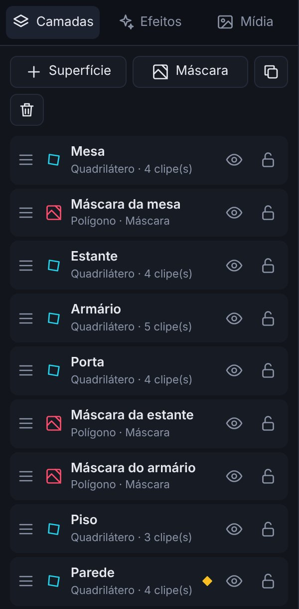

*Figura 12 — Lista de camadas da sala de demonstração. A de cima cobre as de baixo.*

- **A ordem importa:** a superfície do topo da lista é desenhada por último e aparece por cima. Arraste pela alça (☰) para reordenar, ou use as setas no painel de propriedades (atalhos **[** e **]**).
- **Olho:** mostra/oculta. Superfícies ocultas não são projetadas (no editor aparecem tracejadas).
- **Cadeado:** bloqueia a edição.
- Embaixo do nome aparecem o tipo e o conteúdo (por exemplo “Quadrilátero · 4 clipe(s)”). Máscaras têm ícone vermelho. Um losango amarelo indica keyframes.
- Botões do topo: **+ Superfície** (quadrilátero no centro), **Máscara**, **Duplicar** (Ctrl+D) e **Excluir** (Delete — e dá para desfazer).

## 11. Painel de propriedades

O painel muda conforme a seleção. Com uma superfície selecionada ele tem as seções abaixo (clique no título para abrir ou fechar cada uma).

| Topo e geometria | Vértices | Conteúdo de um clipe | Animação |
|---|---|---|---|
| 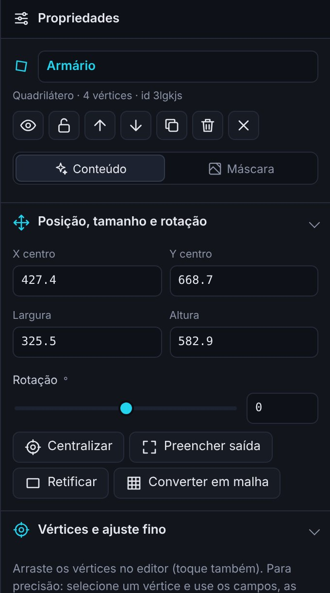 | 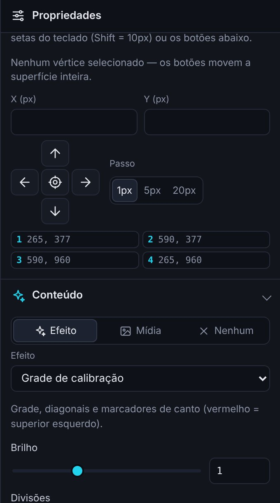 | 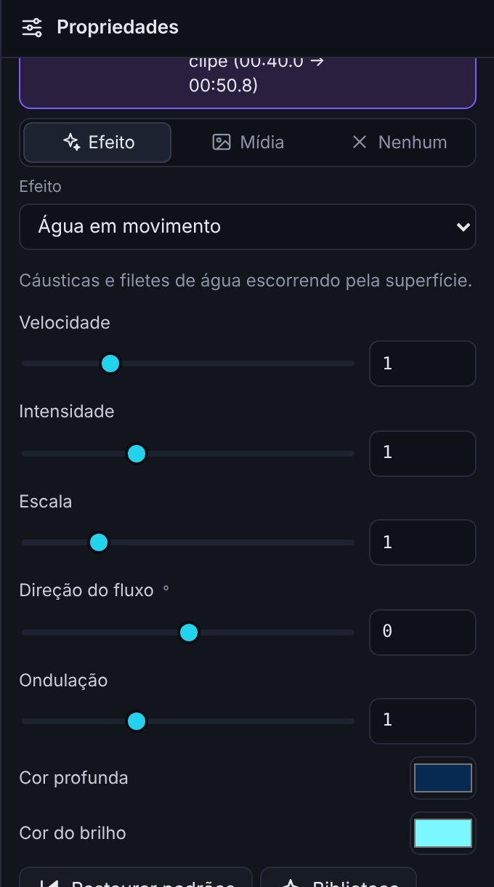 | 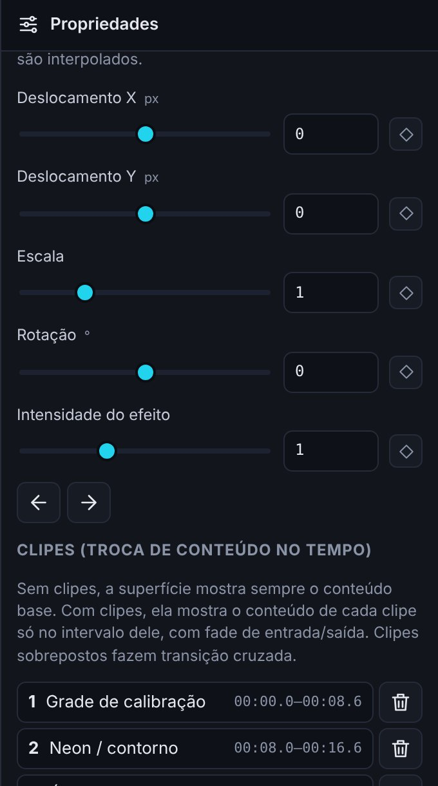 |

*Figura 13 — As seções do painel de propriedades.*

**Cabeçalho.** Nome (editável), tipo, número de vértices e identificador; botões mostrar/ocultar, bloquear, subir/descer camada, duplicar, excluir e desselecionar. A chave **Conteúdo | Máscara** transforma qualquer forma em máscara e vice-versa.

**Posição, tamanho e rotação.**
- **X centro / Y centro:** posição do centro, em pixels da saída.
- **Largura / Altura:** tamanho da caixa que envolve a forma; mudar estica a forma a partir do centro.
- **Rotação:** gira a forma inteira.
- **Centralizar:** leva a forma para o meio do palco. **Preencher saída:** ocupa a tela toda. **Retificar:** desfaz a perspectiva, voltando a um retângulo alinhado.

**Vértices e ajuste fino.** Coordenadas do vértice selecionado, pad de setas com passo de 1, 5 ou 20 pixels e a lista de todos os vértices (clique para selecionar). Nos polígonos: **Adicionar ponto** e **Remover ponto**.

**Conteúdo.** Escolha **Efeito**, **Mídia** ou **Nenhum**.
- *Efeito:* lista de efeitos, descrição e os parâmetros daquele efeito (capítulo 12). **Restaurar padrões** volta aos valores originais.
- *Mídia:* arquivo, e para vídeos e GIFs: pausar, repetir (loop), velocidade, som e volume.
- *Enquadramento do conteúdo:* para mídias, **Cobrir** (preenche cortando sobras), **Conter** (mostra a imagem inteira, com faixas pretas) ou **Esticar**. Para qualquer conteúdo: zoom, deslocamento X/Y, giro, espelhar e, para mídias, repetir lado a lado.

**Aparência e cor.** Opacidade; **Mistura** (Normal, Adicionar — soma luz —, Tela, Multiplicar); **Borda suave** (esfuma a borda em pixels — muito usada para disfarçar pequenos desalinhamentos); brilho, contraste, saturação e matiz.

**Áudio reativo.** O controle **Reação ao som** faz a intensidade do efeito acompanhar o volume (do microfone ou da trilha sonora). Veja o capítulo 13.

**Animação e timeline.** Valores animáveis (deslocamento X/Y, escala, rotação e intensidade do efeito; a opacidade fica em Aparência) com o botão **◆** para gravar keyframes, além da lista de **clipes**. Detalhes no capítulo 15.

**Quando nada está selecionado,** o painel mostra o **projeto**: nome, resolução da saída, foto de referência e simulação, duração e loop da timeline e o perfil de desempenho (figura 5).

## 12. Efeitos e presets

O LuzMap gera todos os efeitos em tempo real pela placa de vídeo, por isso eles não pesam como arquivos de vídeo, se adaptam a qualquer formato de superfície e mudam na hora quando você mexe nos parâmetros.

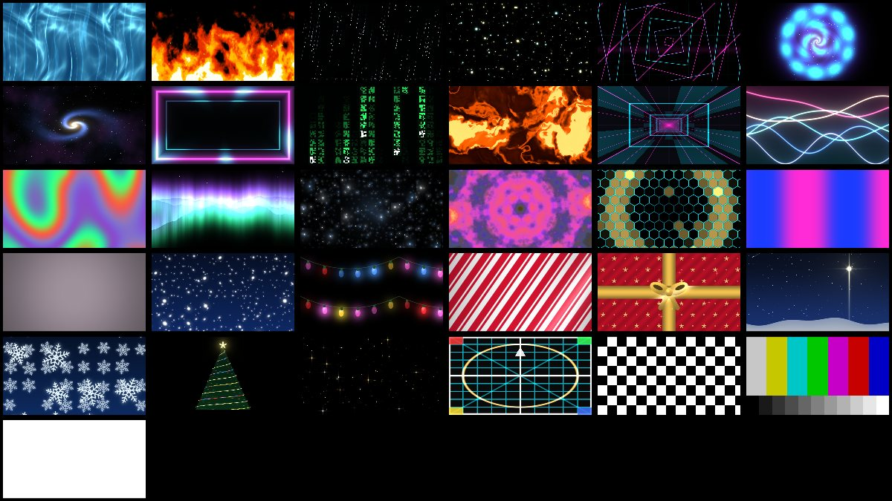

*Figura 14 — A biblioteca completa, na ordem da tabela abaixo (da esquerda para a direita, de cima para baixo).*

**Como aplicar:** com uma superfície selecionada, clique no efeito. Sem nada selecionado, o efeito cria uma superfície nova no centro. No computador também dá para **arrastar o cartão do efeito** até uma superfície no palco. Passe o mouse sobre um cartão para ver a miniatura animada.

| Efeito | O que faz | Ideal para |
|---|---|---|
| Água em movimento | Cáusticas e filetes escorrendo; a direção do fluxo é ajustável | Armários, portas, paredes |
| Fogo | Chamas subindo da base, com faíscas | Lareiras falsas, rodapés, mesas |
| Chuva | Gotas em camadas, névoa e respingos | Janelas, paredes |
| Partículas luminosas | Vaga-lumes/bokeh flutuando | Estantes, tetos |
| Linhas geométricas | Quadrados concêntricos, feixes e grade | Estantes, ambientes tecnológicos |
| Portal espacial | Vórtice com anel de energia | Portas |
| Galáxia | Galáxia espiral, nebulosa e estrelas | Paredes inteiras, tetos |
| Neon / contorno | Contorno luminoso nas bordas da superfície | Destacar móveis e molduras |
| Matrix digital | Chuva de caracteres | Portas, colunas |
| Lava | Lava com crosta escura | Pisos, mesas |
| Ilusão 3D (túnel) | Túnel que “afunda” a superfície | Portas, paredes |
| Ondas coloridas | Ondas luminosas multicoloridas | Paredes, pisos |
| Plasma | Plasma psicodélico | Superfícies pequenas |
| Aurora boreal | Cortinas de luz | Paredes, tetos |
| Viagem estelar | Estrelas vindo na sua direção | Paredes |
| Caleidoscópio | Simetria radial colorida | Círculos, tetos |
| Colmeia hexagonal | Grade hexagonal com ondas de luz | Paredes |
| Gradiente animado | Transição suave entre duas cores | Luz ambiente |
| Pulso / estrobo | Pulsação rítmica (reage ao áudio) | Festas, música |
| Grade de calibração | Grade, diagonais, círculo e cantos coloridos | Alinhar superfícies |
| Xadrez | Quadriculado | Conferir a perspectiva |
| Barras de cor | Barras e rampa de cinza | Ajustar cor/brilho do projetor |
| Cor sólida | Uma cor só (branco = luz pura) | Iluminar objetos, testar |

**Parâmetros comuns** (cada efeito mostra só os que usa, às vezes com nomes mais específicos):

| Parâmetro | Faixa | Efeito |
|---|---|---|
| Velocidade | 0 a 4 | Rapidez da animação (0 = parado). |
| Intensidade | 0 a 3 | Brilho geral do efeito. |
| Escala | 0,2 a 4 | Tamanho dos elementos (gotas, linhas, caracteres…). |
| Densidade | 0,05 a 3 | Quantidade de elementos (estrelas, gotas, partículas). |
| Direção | −180° a 180° | Sentido do movimento (fluxo da água, inclinação da chuva…). |
| Frequência | 0,1 a 5 | Repetições (anéis, ondas, braços do portal, divisões da grade). |
| Amplitude | 0 a 3 | Força da ondulação, altura das chamas, torção. |
| Cor 1 / Cor 2 | — | As duas cores principais. |

**Presets** (no topo da aba Efeitos) são combinações prontas. Com uma superfície selecionada, o preset muda só o conteúdo dela. Sem seleção, ele cria superfícies novas:

- **Parede animada** — ondas coloridas com borda suave;
- **Porta dimensional** — portal espacial;
- **Armário iluminado** — contorno neon;
- **Estante futurista** — linhas geométricas;
- **Ambiente espacial** — galáxia na parede inteira;
- **Projeção geométrica** — cria três formas: triângulo com colmeia, quadrado com túnel 3D e triângulo com linhas.

## 13. Mídia: imagens, vídeos, GIFs e áudio

**Importar:** aba **Mídia → Importar arquivos**, clique na área tracejada ou **arraste arquivos para qualquer lugar da janela**. Se você soltar uma imagem ou vídeo em cima de uma superfície, ela é aplicada ali.

**Formatos:** JPG, PNG, WebP, GIF, SVG, MP4, WebM, MOV (quando o navegador suporta), MP3, WAV, M4A e outros que o navegador consiga abrir. Imagens maiores que 4096 pixels são reduzidas automaticamente.

**Onde os arquivos ficam:** no armazenamento interno do navegador (IndexedDB), **só neste dispositivo**. Nada é enviado para a internet. A barra no fim da aba mostra quanto espaço está em uso.

Cada item da lista tem botões:

- **✓ Aplicar** na superfície selecionada (ou cria uma);
- **casinha:** usar como **foto de referência** (imagens);
- **nota musical:** usar como **trilha sonora** (áudios);
- **lixeira:** excluir do dispositivo.

**Vídeos:** tocam em loop junto com a timeline. Começam sem som (os navegadores exigem isso); ligue o som em **Propriedades → Conteúdo → Som do vídeo**. Se o navegador bloquear o áudio, toque em ▶ para liberar. Velocidade, pausa e loop ficam na mesma seção. Prefira MP4 (H.264) ou WebM, que funcionam em praticamente todos os navegadores.

**GIF animado:** anima nos navegadores que oferecem o recurso `ImageDecoder` (Chrome, Edge e versões recentes do Safari e do Firefox); nos outros, aparece parado e o app avisa.

**Trilha sonora e áudio reativo:** um áudio definido como trilha toca sincronizado com a timeline. Ele, o som dos vídeos ou o **microfone** (menu → *Áudio reativo: usar microfone*) alimentam o **áudio reativo**: superfícies com **Reação ao som** maior que zero pulsam com a música. O efeito **Pulso / estrobo** foi feito para isso.

**Mídia ausente:** um projeto guarda só a *referência* ao arquivo. Se você abrir o projeto em outro aparelho (ou apagar a mídia), o item aparece como **Arquivo ausente — importe novamente**, e o app avisa ao abrir o projeto. Para levar as mídias junto, use **Exportar com mídias** (capítulo 19).

## 14. Máscaras

Uma máscara é uma forma que **pinta de preto tudo o que está abaixo dela na lista de camadas**. Preto, para o projetor, significa “sem luz”. Ela serve para:

- não projetar na parede vizinha, num quadro ou na televisão;
- impedir que o conteúdo de uma parede “vaze” sobre um móvel que está na frente;
- recortar formatos complexos.

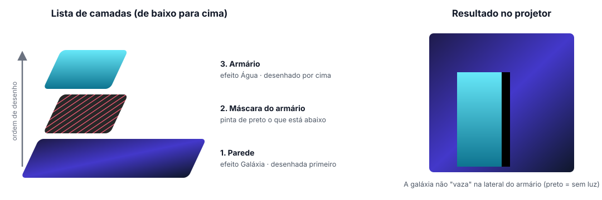

*Figura 15 — A máscara fica entre a parede e o armário: a parede é escurecida atrás do móvel, o armário (acima da máscara) não é afetado.*

| No editor (máscara selecionada) | O que vai para o projetor |
|---|---|
| 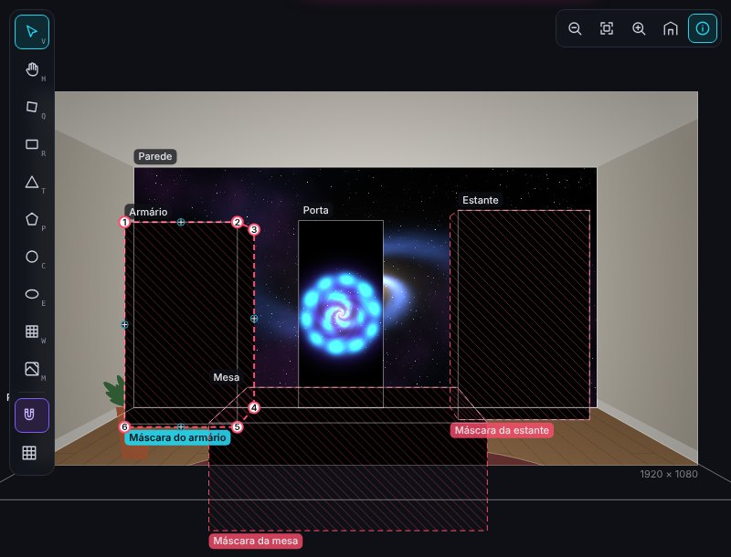 | 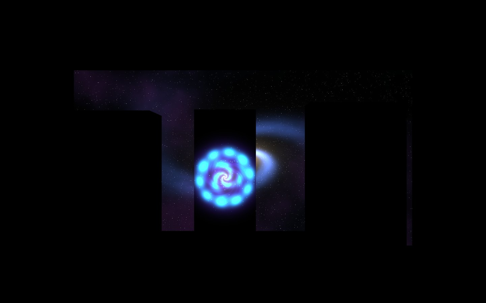 |

*Figura 16 — No editor, as máscaras aparecem com hachuras vermelhas para você enxergá-las. Na saída, são simplesmente preto.*

**Como criar:** ferramenta **Máscara** (M) — cliques para um polígono ou arraste para um retângulo —, o botão **Máscara** do painel de camadas, ou a chave **Conteúdo | Máscara** de qualquer superfície.

**Ajustes da máscara:**
- **Inverter:** passa a esconder tudo o que está **fora** da forma (útil para “só projetar dentro desta área”);
- **Opacidade:** 100% esconde totalmente; valores menores apenas escurecem;
- **Borda suave:** transição gradual da borda (vale para a máscara normal).

> [!IMPORTANT]
> A máscara só afeta o que está **abaixo** dela na lista. Se ela não estiver escondendo algo, confira a ordem das camadas: a máscara precisa ficar acima da superfície a ser escondida.

## 15. Timeline: tocar, clipes e keyframes

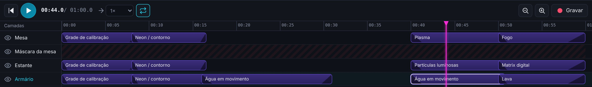

*Figura 17 — Timeline com clipes (barras roxas) e a agulha (linha rosa).*

**Transporte:**

| Controle | Função |
|---|---|
| ⏮ (Home) | Volta ao início |
| ▶ / ⏸ (Espaço) | Toca ou pausa. Pausado, tudo congela — efeitos, vídeos e animações —, ótimo para inspecionar. |
| Tempo | Posição atual / duração |
| Velocidade | 0,25× a 4× |
| Loop | Repetir ao chegar ao fim |
| Lupas | Zoom da timeline (ou Ctrl + roda do mouse) |
| Gravar | Abre o gravador (capítulo 20) |

**Agulha:** arraste na régua (números de tempo) para ir a qualquer instante. A duração do projeto fica em **Propriedades do projeto → Timeline**.

**Trilhas:** uma linha por superfície, na mesma ordem das camadas. O **olho** liga e desliga a camada. Uma faixa tracejada indica que a superfície mostra o **conteúdo base** o tempo todo.

**Clipes — trocar conteúdo ao longo do tempo.** Sem clipes, a superfície mostra sempre o mesmo conteúdo. Quando uma superfície tem clipes, ela mostra o conteúdo de cada clipe **apenas no intervalo dele**, e fica apagada fora deles.

- **Criar:** botão **Clipe na agulha** (em Propriedades → Animação e timeline) ou **duplo clique** num espaço vazio da trilha. O clipe nasce com 5 segundos e o conteúdo atual.
- **Mover:** arraste o clipe. Ele encaixa em passos de 0,1 s e “gruda” na agulha.
- **Mudar a duração:** arraste as bordas esquerda ou direita.
- **Editar o conteúdo:** clique no clipe. O painel mostra a faixa roxa “Editando o conteúdo do clipe”; agora escolher efeitos, mídia ou parâmetros altera só esse clipe.
- **Transições:** cada clipe tem **fade de entrada** e **fade de saída** (os triângulos escuros nas pontas). Clipes sobrepostos fazem **transição cruzada**, um aparecendo enquanto o outro some.
- **Excluir:** selecione e pressione **Delete**, ou use a lixeira na lista de clipes.

**Keyframes — animar propriedades.** Um keyframe guarda o valor de uma propriedade num instante; entre dois keyframes o LuzMap calcula os valores intermediários suavemente. Podem ser animados: **deslocamento X e Y, escala, rotação, opacidade e intensidade do efeito**.

Exemplo — fazer a galáxia “acender” devagar:

1. Leve a agulha para 0 s, ponha **Opacidade** em 0 e clique em **◆** (fica amarelo e preenchido).
2. Leve a agulha para 3 s e mude a opacidade para 1. Como a propriedade já tem keyframes, o novo valor cria um keyframe automaticamente.
3. Toque: a superfície aparece aos poucos ao longo de 3 segundos.

Os keyframes aparecem como **losangos amarelos** na trilha: clique para ir até eles, arraste para mudar o momento, **Delete** para apagar. As setas ← → no painel pulam de keyframe em keyframe. **Apagar keyframes** remove todos da superfície.

> [!NOTE]
> Os efeitos usam um relógio contínuo. Quando a timeline recomeça (loop), clipes e keyframes voltam ao início, mas a animação interna dos efeitos não dá “saltos”.

## 16. Calibração

A calibração serve para alinhar o virtual com o real. Clique em **Calibrar** na barra superior: abre um painel flutuante que não bloqueia o editor, então você pode arrastar vértices com ele aberto.

| Assistente (passo 4 de 6) | Modo avançado |
|---|---|
| 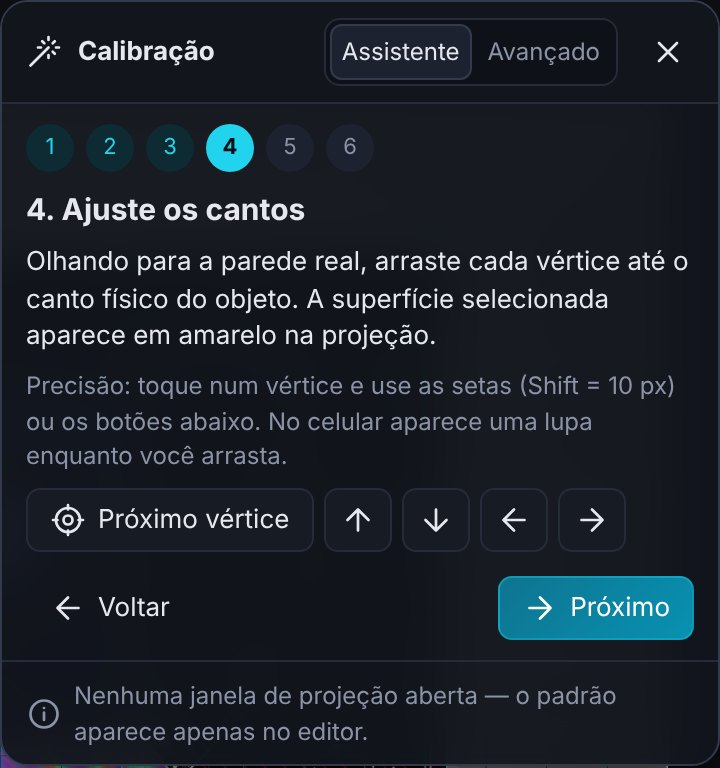 | 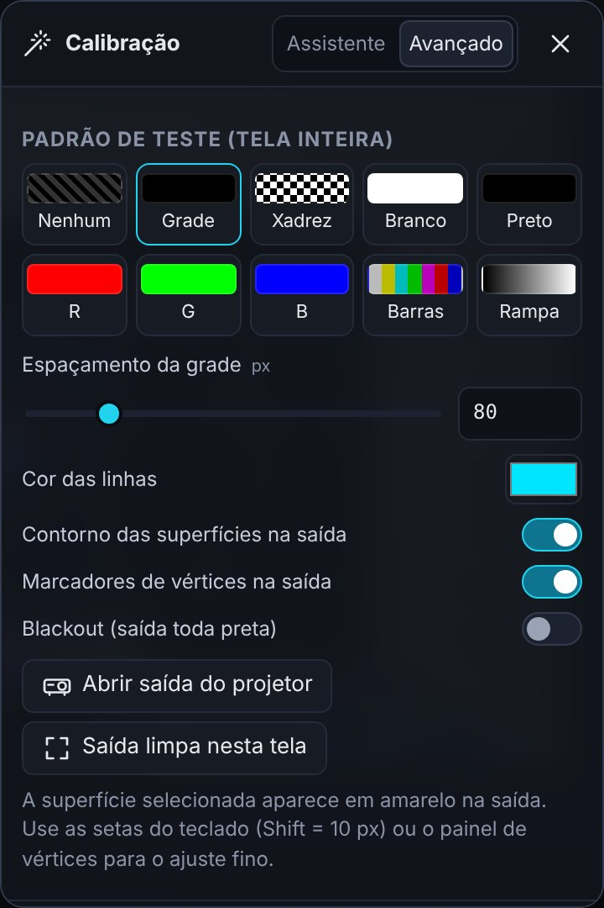 |

*Figura 18 — O painel de calibração.*

**Assistente em 6 passos:**

1. **Resolução da projeção:** escolha a do projetor (ou **Detectar desta tela**).
2. **Exibir a grade:** a grade aparece na saída. Abra a janela do projetor ou a saída limpa.
3. **Adicionar uma superfície:** um quadrilátero no centro, ou desenhe tocando nos cantos.
4. **Ajustar os cantos:** olhando para a parede, leve cada vértice ao canto real. A superfície selecionada aparece **em amarelo** na projeção e os vértices ganham marcadores em cruz.
5. **Conteúdo de teste:** aplique **Grade de teste**, **Xadrez** ou **Branco** dentro da superfície. As linhas devem ficar retas e paralelas às bordas do objeto; o quadrado vermelho deve estar no canto superior esquerdo.
6. **Salvar:** guarda o projeto e oferece a escolha de um efeito.

**Modo avançado:**

- **Padrões de tela inteira:** Grade (com cruz central, círculos, diagonais e bordas), Xadrez, Branco, Preto, Vermelho, Verde, Azul, Barras de cor e Rampa de cinza.
- **Espaçamento da grade** (10 a 400 pixels) e **cor das linhas**.
- **Contorno das superfícies** e **marcadores de vértices** projetados.
- **Blackout:** a saída inteira fica preta.

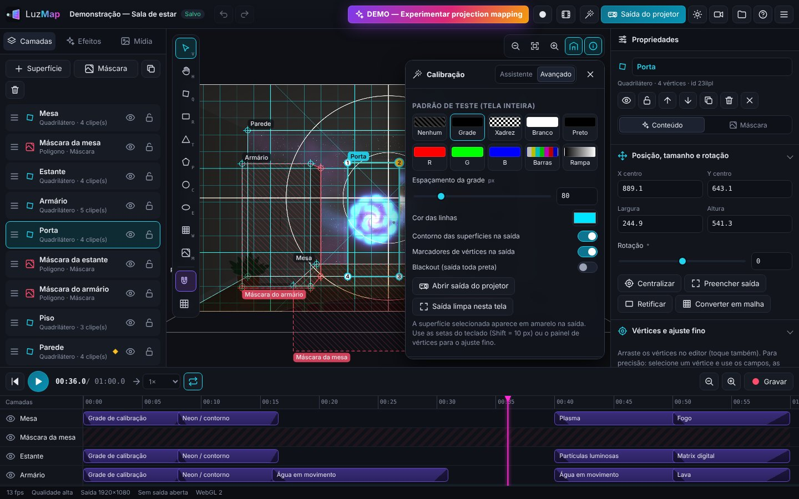

*Figura 19 — Grade de tela inteira com contornos e marcadores. A porta (selecionada) aparece em amarelo.*

Ao fechar o painel, padrões, contornos e marcadores são desligados.

> [!TIP]
> **Dicas de alinhamento:** comece pelas superfícies maiores (parede), depois as menores. Use o padrão **Branco** para enxergar bem as bordas físicas. Se sobrar um fio de luz na borda, use **Borda suave** de 2 a 6 pixels ou recue o vértice 1 pixel.

## 17. Saída para o projetor

O botão **Saída do projetor** (tecla **O** no computador) oferece:

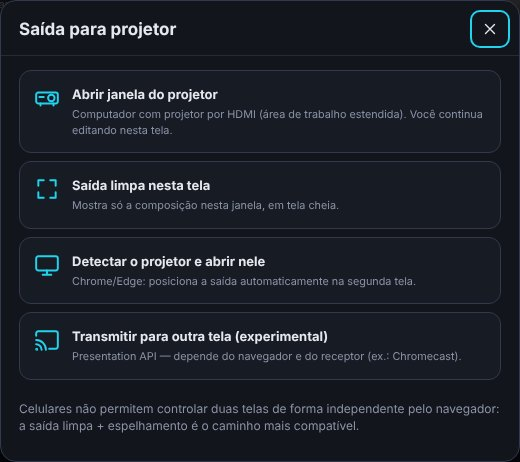

*Figura 20 — As opções de saída.*

**1. Abrir janela do projetor** (computador). Abre uma janela separada que mostra **somente a composição**, em fundo preto, sem menus, alças ou grade. Você continua editando na tela principal e cada alteração aparece na projeção em uma fração de segundo.

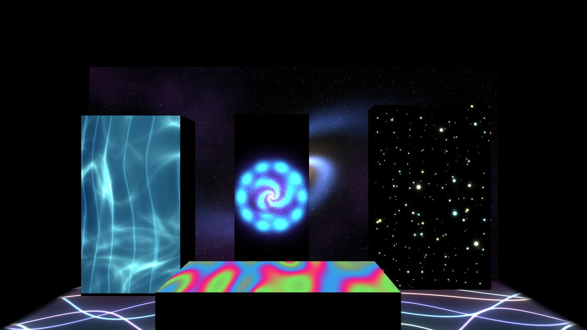

*Figura 21 — A janela de saída.*

Na janela de saída:

- **clique** (ou **F**, ou **duplo clique**) para entrar em **tela cheia**;
- mexa o mouse para ver a barra de informações: conexão, resolução real, fps e os botões **Tela cheia**, **Ajuste** (manter proporção ou esticar) e **Fechar**. O cursor some sozinho;
- a tela é mantida ligada (sem descanso de tela), quando o navegador permite;
- se for aberta sozinha (sem o editor), ela mostra o último projeto salvo;
- ela não toca som, para evitar eco: o áudio sai pelo editor.

**2. Detectar o projetor e abrir nele** (Chrome e Edge). O navegador pede permissão para gerenciar janelas, encontra a segunda tela e já abre a saída nela.

**3. Saída limpa nesta tela.** Esconde toda a interface e mostra só a composição na própria tela, em tela cheia quando possível. É a opção para **celulares e tablets** (com espelhamento de tela ou adaptador). Toque na tela para ver o botão **Sair da saída limpa**; no teclado, **Esc** ou **F**.

**4. Transmitir para outra tela (experimental).** Usa a Presentation API para telas sem fio, quando o navegador e o receptor oferecem.

**Blackout (tecla B ou o sol na barra):** deixa a saída inteiramente preta na hora — útil entre apresentações.

### Passo a passo: Formovie S5 com Windows

1. Abra o LuzMap no **Chrome** ou no **Edge** e abra seu projeto.
2. Ligue o Formovie S5 ao computador com um cabo **HDMI**.
3. Pressione **Windows + P** e escolha **Estender**.
4. Defina a resolução do projeto como **1920 × 1080** (Propriedades do projeto ou passo 1 do assistente).
5. Clique em **Saída do projetor → Detectar o projetor e abrir nele** e permita. Se preferir, use **Abrir janela do projetor** e arraste a janela para a tela do projetor.
6. Clique na janela do projetor e pressione **F** (tela cheia).
7. Volte à tela do notebook e ajuste os vértices olhando para a parede. Use **Calibrar** para ver contornos e marcadores na projeção.

### Celular e tablet

Navegadores de celular **não conseguem controlar duas telas separadas**: o celular sempre mostra na TV ou no projetor o mesmo que está na própria tela. Por isso:

1. Conecte o projetor por **adaptador USB-C → HDMI** ou por **espelhamento sem fio** (Smart View, Miracast, AirPlay…).
2. Faça o mapping olhando para a parede, como no computador.
3. Toque em **Saída do projetor → Saída limpa nesta tela**: a interface some e só a projeção fica na tela espelhada.

> [!WARNING]
> **iPhone:** o Safari não deixa páginas entrarem em tela cheia (só vídeos). Para ocupar a tela toda, toque em Compartilhar → **Adicionar à Tela de Início** e abra o LuzMap pelo ícone criado.

## 18. Foto de referência e simulação

Você pode planejar todo o mapping **antes de ligar o projetor**:

1. Tire uma foto do ambiente **a partir do lugar onde o projetor vai ficar**, com o mesmo enquadramento.
2. Importe a foto (aba **Mídia**) e clique na **casinha** para usá-la como fundo.
3. Desenhe as superfícies sobre os objetos da foto.
4. Ligue a **Simulação** (casinha nos controles da vista) para ver a luz projetada sobre a foto.

| Simulação (luz sobre o ambiente) | Saída real (o que o projetor recebe) |
|---|---|
| 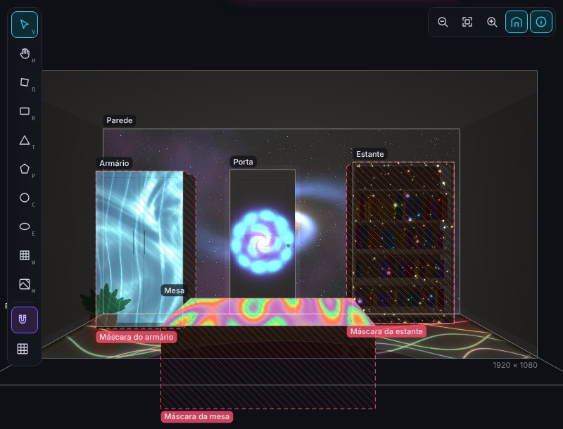 | 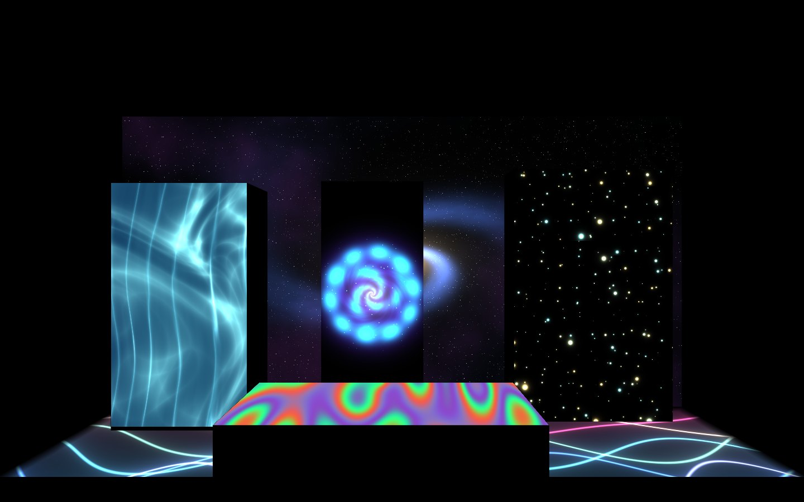 |

*Figura 22 — À esquerda, como a sala ficaria iluminada; à direita, a imagem que realmente sai do projetor.*

A simulação escurece a foto (como uma sala com a luz apagada) e soma a luz projetada respeitando a cor de cada superfície — objetos claros refletem mais. A foto **nunca é enviada ao projetor**. Sem foto, a simulação usa um fundo cinza neutro.

## 19. Projetos: salvar, abrir, exportar

**Salvamento automático:** toda alteração é salva cerca de 1,5 segundo depois, no próprio navegador. O selo ao lado do nome mostra o estado. **Ctrl+S** salva na hora e atualiza a miniatura.

**Recuperação:** ao reabrir o site, o último projeto volta sozinho.

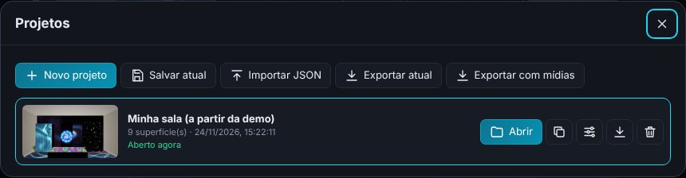

*Figura 23 — Projetos salvos neste dispositivo.*

Na janela **Projetos** (clique no nome do projeto ou use Ctrl+O):

| Botão | O que faz |
|---|---|
| Novo projeto | Começa do zero (o atual continua salvo) |
| Salvar atual | Salva agora |
| Importar JSON | Abre um projeto exportado |
| Exportar atual | Baixa um `.luzmap.json` pequeno (sem as mídias) |
| Exportar com mídias | Inclui imagens e vídeos dentro do JSON — arquivo maior, mas abre completo em qualquer aparelho |
| Abrir / Duplicar / Renomear / Exportar / Excluir | Ações de cada projeto da lista |

> [!IMPORTANT]
> Projetos e mídias ficam **no navegador deste aparelho**. Limpar os dados do site apaga tudo. Para guardar uma cópia de segurança ou levar para outro computador, use **Exportar com mídias**. Ao abrir um projeto sem as mídias, o LuzMap avisa quais arquivos precisam ser importados de novo.

Também é possível arrastar um arquivo `.luzmap.json` para a janela. O repositório traz um exemplo: `demos/exemplo-sala.luzmap.json` (a sala da demonstração).

## 20. Gravar vídeo

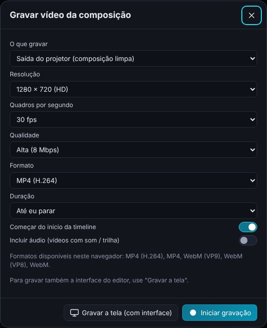

*Figura 24 — Opções de gravação. Só aparecem os formatos que o seu navegador realmente consegue gravar.*

Abra pelo botão **Gravar** da timeline (ou pelo ícone de câmera na barra superior):

- **O que gravar:** a **saída do projetor** (composição limpa) ou a **simulação no ambiente**;
- **Resolução, quadros por segundo** (24/30/60) e **qualidade** (4, 8 ou 16 Mbps);
- **Formato:** MP4 quando o navegador grava MP4 de verdade; senão WebM;
- **Duração:** até você parar, 10/30/60 s ou a timeline inteira;
- **Começar do início da timeline** e **incluir áudio** (som de vídeos e da trilha).

Durante a gravação aparece o selo **REC** com o botão **Parar**. No fim, uma prévia e o botão **Baixar vídeo**.

- **GRAVAR DEMONSTRAÇÃO:** inicia a demo e grava os 60 segundos completos em 1280 × 720, com a simulação da sala; o arquivo é oferecido para download ao final.
- **Gravar a tela (com interface):** no computador, grava a aba ou a tela inteira, incluindo o editor — útil para tutoriais.

## 21. O modo DEMO

O botão **DEMO — Experimentar projection mapping** carrega uma sala de estar virtual — **parede, piso, porta, armário, estante e mesa**, desenhados em perspectiva real — já mapeada com 9 superfícies (6 de conteúdo e 3 máscaras), e toca uma apresentação de 60 segundos em 7 cenas:

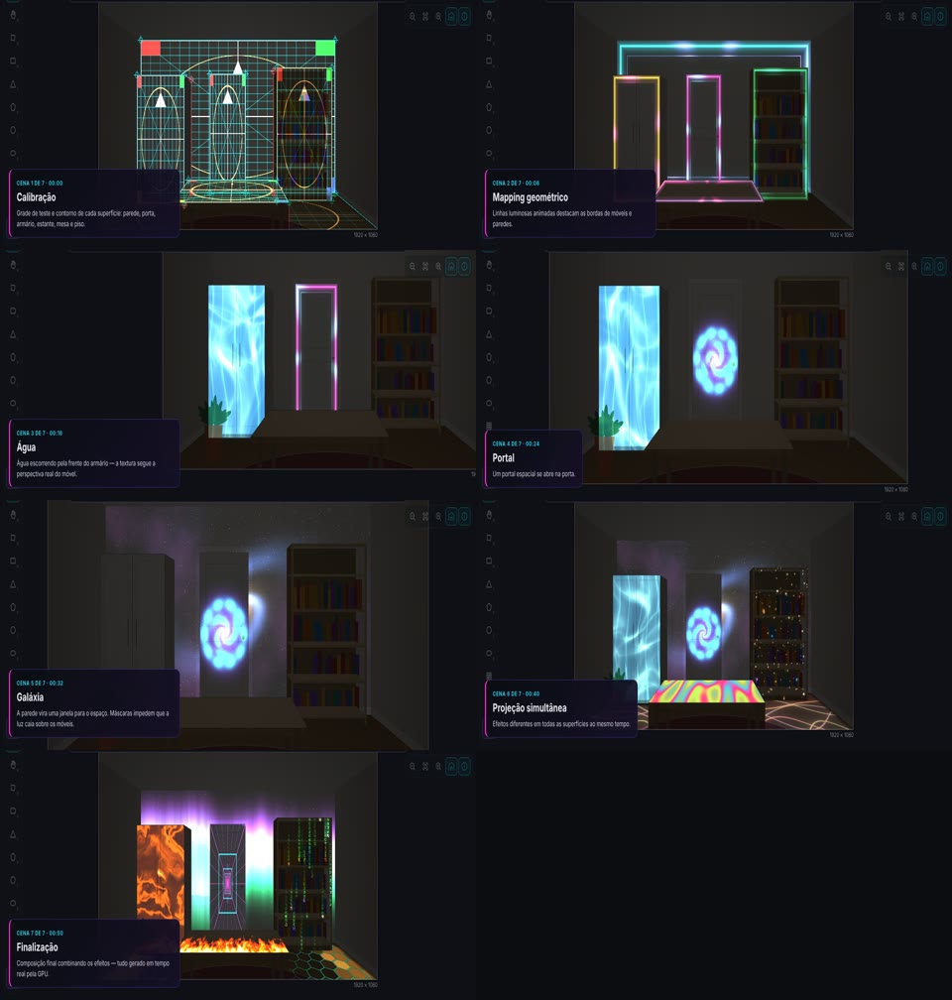

*Figura 25 — Cenas 1 a 7, da esquerda para a direita e de cima para baixo.*

| Cena | Início | O que mostra |
|---|---|---|
| 1. Calibração | 0 s | Grade de teste e contorno de cada superfície |
| 2. Mapping geométrico | 8 s | Linhas neon contornando paredes e móveis |
| 3. Água | 16 s | Água escorrendo na frente do armário (a câmera se aproxima) |
| 4. Portal | 24 s | Portal espacial na porta |
| 5. Galáxia | 32 s | A parede vira uma janela para o espaço; as máscaras protegem os móveis |
| 6. Projeção simultânea | 40 s | Efeitos diferentes em todas as superfícies |
| 7. Finalização | 50 s | Composição final: aurora, túnel 3D, lava, matrix, fogo e colmeia |

**Barra da demo:** números das cenas (clique para pular), progresso, pausa, **Sala/Saída** (alterna entre a simulação e a imagem pura do projetor), **Projetor** (envia a demo para a saída), **Gravar demonstração**, **Editar** e **Sair**.

> [!TIP]
> **Aprenda com a demo:** clique em **Editar**. A sala vira um projeto normal e editável (“Minha sala (a partir da demo)”) e você pode examinar como cada clipe, máscara e keyframe foi montado. **Sair** volta ao projeto que estava aberto antes.

## 22. Desempenho e qualidade

Os efeitos são calculados pela GPU para cada pixel, a cada quadro. Em aparelhos modestos isso pesa; por isso há **perfis de qualidade** (Propriedades do projeto → Desempenho):

| Perfil | Para quem | O que muda |
|---|---|---|
| Automático (padrão) | Todos | Escolhe pelo aparelho e **reduz sozinho** se a fluidez cair abaixo de ~28 fps por alguns segundos |
| Baixa | Celulares mais simples | Menos detalhes nos efeitos e resolução interna menor |
| Média | Celulares modernos e notebooks | Equilíbrio |
| Alta | Computadores com placa de vídeo | Máximo de detalhe |

A barra de status mostra os fps atuais. O LuzMap desenha **só quando algo muda ou está tocando**: com a timeline pausada e nada sendo editado, ele praticamente não consome energia.

**Dicas:**

- vídeos 4K pesam no celular — prefira 1080p ou menos;
- muitas superfícies grandes com efeitos pesados (lava, galáxia, água) somam custo;
- **Borda suave** em polígonos é mais cara que em quadriláteros;
- se a placa de vídeo “reiniciar” (perda de contexto WebGL), o LuzMap avisa e recupera a imagem sozinho.

## 23. Instalar como aplicativo e usar offline

O LuzMap é um **PWA** (aplicativo web progressivo):

- **Computador (Chrome/Edge):** menu do navegador → *Instalar LuzMap* (ou o ícone de celular na barra do app, quando aparece).
- **Android:** menu do Chrome → *Instalar app* / *Adicionar à tela inicial*.
- **iPhone/iPad:** Safari → Compartilhar → *Adicionar à Tela de Início*.

Depois do primeiro acesso, **o aplicativo abre mesmo sem internet**. Suas mídias já estão no aparelho; só o vídeo de demonstração do site precisa de conexão. Quando houver uma versão nova, aparece o aviso “Nova versão do LuzMap disponível — Atualizar”.

---

# Parte 4 — Como o sistema funciona por dentro

Esta parte é para quem quer entender o código ou modificá-lo. O LuzMap é escrito em HTML, CSS e JavaScript puros (módulos ES), **sem bibliotecas externas e sem etapa de compilação**: os arquivos do repositório são exatamente os que o navegador executa.

## 24. Arquitetura: quem faz o quê

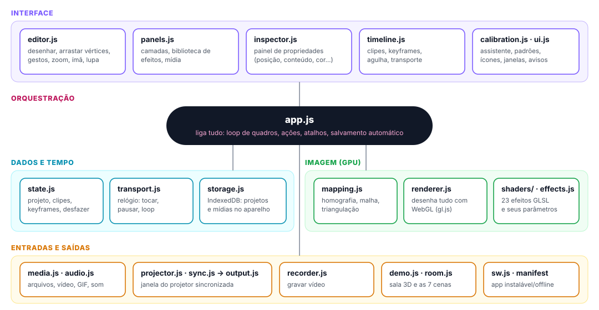

*Figura 26 — Módulos do sistema.*

| Arquivo | Papel |
|---|---|
| `index.html`, `css/style.css` | Estrutura e visual do editor (grade no computador, painéis deslizantes no celular). |
| `js/app.js` | O “maestro”: inicia tudo, roda o laço de quadros, executa as ações dos botões, atalhos de teclado, salvamento automático e janelas (projetos, gravação, ajuda). |
| `js/editor.js` | Interação com o palco: ferramentas, seleção, arrasto de vértices, ímã, gestos de toque, zoom, lupa e o desenho das alças por cima da imagem. |
| `js/state.js` | O **modelo de dados**: projeto, superfícies, clipes, keyframes; cálculo do que cada superfície mostra em cada instante; desfazer/refazer. |
| `js/mapping.js` | Matemática: homografia, triangulação de polígonos, malhas e contornos. |
| `js/renderer.js`, `js/gl.js` | O motor gráfico WebGL que desenha a composição em qualquer tela (editor, projetor, gravador, miniaturas). |
| `shaders/common.js`, `shaders/effects.js` | Programas que rodam na GPU: a etapa comum de cada superfície e os 23 efeitos. |
| `js/effects.js`, `js/presets.js` | Catálogo de efeitos (nomes, parâmetros, valores padrão) e presets. |
| `js/media.js`, `js/audio.js` | Importação e reprodução de imagens, GIFs, vídeos e áudio; análise de som. |
| `js/storage.js` | Banco de dados local (IndexedDB) para projetos e mídias. |
| `js/panels.js`, `js/inspector.js`, `js/timeline.js` | Painéis de camadas/efeitos/mídia, propriedades e timeline. |
| `js/transport.js` | O relógio: tocar, pausar, velocidade, loop. |
| `js/projector.js`, `js/sync.js`, `output.html`, `js/output.js` | A janela do projetor e a comunicação entre janelas. |
| `js/calibration.js` | Painel de calibração e assistente. |
| `js/recorder.js` | Gravação de vídeo. |
| `js/demo.js`, `js/room.js` | A demonstração e a sala 3D. |
| `js/capabilities.js` | Detecta o que o navegador suporta e escolhe o perfil de qualidade. |
| `sw.js`, `manifest.webmanifest` | Funcionamento offline e instalação como app. |

**O laço de quadros.** Cerca de 60 vezes por segundo, o `app.js`:

1. avança o relógio (se estiver tocando);
2. atualiza animações da vista, a demo e o áudio;
3. sincroniza os vídeos com o tempo da timeline;
4. **se algo mudou ou está tocando**, pede ao renderizador para desenhar o palco e ao editor para desenhar as alças por cima;
5. envia o estado às janelas de projeção e alimenta o gravador, se houver.

**Eventos.** Quando você muda qualquer coisa, o código altera o projeto e avisa “mudou” (`store.changed`). Quem se interessa reage: o renderizador redesenha, os painéis se atualizam, a janela do projetor recebe a novidade e o salvamento automático é agendado.

**Desfazer/refazer.** Antes de cada alteração o projeto inteiro é fotografado como texto (JSON). Desfazer é voltar à foto anterior. Arrastos e movimentos de slider viram uma única etapa, e o histórico guarda até 120 passos.

## 25. A correção de perspectiva, explicada

Imagine o conteúdo (uma imagem, um vídeo, um efeito) como um quadrado de borracha com uma grade desenhada. Você prende os quatro cantos nos quatro vértices da superfície. Há duas formas de esticar a borracha:

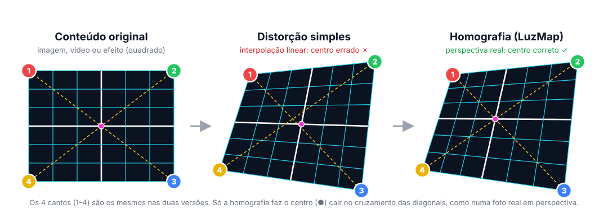

*Figura 27 — Os mesmos 4 cantos, duas distorções diferentes.*

- **Distorção simples (interpolação linear):** divide cada borda em partes iguais. O centro do conteúdo fica na média dos quatro cantos. Parece aceitável, mas **não é como uma superfície real aparece em perspectiva**: numa porta vista de lado, o lado mais distante parece menor e as linhas se aproximam.
- **Homografia (o que o LuzMap usa):** a transformação exata de um plano visto em perspectiva, a mesma da fotografia. As linhas se aproximam no lado “distante” e o **centro do conteúdo cai no cruzamento das diagonais** — como acontece quando você fotografa um quadro de lado.

**Como é calculada.** Uma homografia é uma tabela 3 × 3 de números (matriz *H*) que leva cada ponto do quadrado de conteúdo `(u, v)` a um ponto da saída `(x, y)`. Com os 4 cantos conhecidos, a função `squareToQuad` em `js/mapping.js` resolve os 8 números desconhecidos com fórmulas diretas.

**Como a GPU aplica.** A placa de vídeo desenha triângulos e interpola valores *linearmente* entre os vértices — o que, sozinho, produziria a distorção simples. O truque: em cada vértice o LuzMap envia três valores `(U, V, W) = H⁻¹·(x, y, 1)`. Esses três valores **variam linearmente na tela**, então a interpolação da GPU é exata para eles. No fim, para cada pixel, o programa da GPU divide `U/W` e `V/W` e obtém a posição correta no conteúdo. Resultado: perspectiva perfeita em cada pixel, com custo mínimo. Os testes automáticos verificam isso conferindo a cor do pixel no cruzamento das diagonais.

**Outras formas:**

- **Triângulo:** um triângulo não tem informação de perspectiva; usa-se uma transformação afim (caso particular da homografia).
- **Malha:** cada célula da grade tem a sua própria homografia — por isso ela acompanha superfícies curvas por partes.
- **Polígono:** é dividido em triângulos (algoritmo *ear clipping*), e o conteúdo é aplicado “de frente”, proporcional ao retângulo que envolve o polígono.
- **Círculo e elipse:** são quadriláteros com homografia; o programa da GPU recorta o formato redondo dentro do quadrado de conteúdo.

## 26. Como cada quadro é desenhado

Para cada superfície, de baixo para cima na lista de camadas, o renderizador (`js/renderer.js`):

1. **Avalia o instante:** a superfície está visível? Qual a opacidade, o deslocamento, a escala e a rotação neste tempo (keyframes)? Quais conteúdos estão ativos (clipes) e com que transparência (fades)? — `evaluateSurface` em `js/state.js`.
2. **Gera a geometria:** triângulos com as coordenadas `(x, y)` e `(U, V, W)` — `buildGeometry` em `js/mapping.js`.
3. **Escolhe o programa da GPU:** o do efeito (cada efeito é um programa compilado uma vez e guardado), o de mídia (lê a textura da imagem ou do quadro atual do vídeo) ou o de máscara.
4. **Envia os parâmetros:** tempo, tamanho em pixels, cores, velocidade, ajustes de cor, borda suave, nível de áudio etc.
5. **Desenha com a mistura escolhida** (normal, adicionar, tela, multiplicar).

Dentro da GPU, cada pixel passa pela mesma sequência (`shaders/common.js`): calcula a posição no conteúdo (divisão por *W*) → recorta o formato (círculo, triângulo…) e calcula a borda suave → aplica zoom, deslocamento, giro e espelhamento do conteúdo → obtém a cor do efeito ou da mídia → ajusta brilho, contraste, saturação e matiz → aplica a opacidade.

**Máscaras invertidas** usam o *stencil* da GPU: a forma é marcada numa camada invisível e depois tudo o que **não** foi marcado é pintado de preto.

**Simulação:** a composição é desenhada primeiro numa imagem fora da tela; depois cada pixel da foto é combinado assim: `foto × (luz_ambiente + luz_projetada × ganho)`.

**Calibração:** padrões de tela inteira (grade, xadrez, cores) são outro programa da GPU; contornos e marcadores são linhas grossas desenhadas por cima.

**Robustez:** se a GPU perder o contexto (acontece em celulares), todos os recursos são recriados automaticamente. Texturas de mídias sem uso há algum tempo são descartadas para liberar memória.

## 27. Como o editor conversa com a janela do projetor

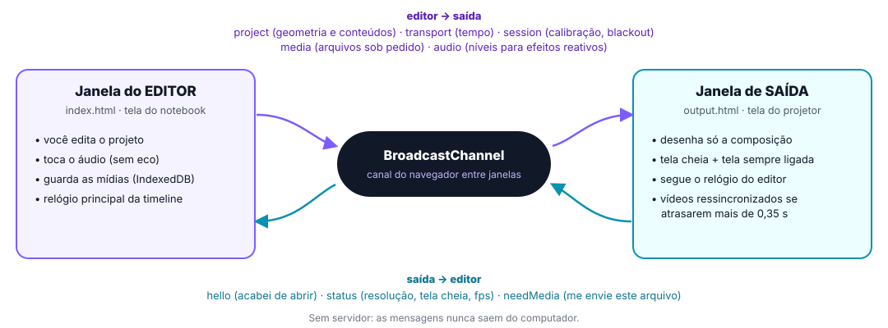

*Figura 28 — Mensagens trocadas pelo BroadcastChannel.*

As duas janelas são da mesma origem (mesmo site), então usam o **BroadcastChannel**, um canal de mensagens do próprio navegador. Nada passa pela internet.

- **project:** o projeto inteiro (geometrias, conteúdos, clipes…), enviado a cada mudança — no máximo cerca de 30 vezes por segundo durante arrastos;
- **transport:** o tempo da timeline, se está tocando e a velocidade, com o horário do envio. A janela de saída compensa o atraso da mensagem e só corrige o próprio relógio se ele se afastar mais de 0,08 s;
- **session:** calibração (padrões, contornos, superfície selecionada) e blackout;
- **media:** quando a saída precisa de um arquivo que não encontra no armazenamento, ela pede (`needMedia`) e o editor envia;
- **audio:** níveis de som para os efeitos reativos.

A janela de saída responde com **hello** ao abrir e com **status** (resolução, tela cheia, fps) a cada segundo — é assim que a barra de status do editor mostra “1 projetor(es) conectado(s)”. Cada janela decodifica os próprios vídeos e os ressincroniza se a diferença passar de 0,35 s.

## 28. Como os dados são guardados

Um projeto é um objeto JSON. Exemplo resumido com uma superfície:

```json
{
  "id": "p_…",
  "name": "Minha sala",
  "output": { "width": 1920, "height": 1080 },
  "timeline": { "duration": 30, "loop": true },
  "background": { "mediaId": "builtin:room", "opacity": 0.55 },
  "media": { "m_…": { "name": "cachoeira.mp4", "kind": "video", "loop": true, "speed": 1 } },
  "surfaces": [
    {
      "id": "s_…",
      "name": "Porta",
      "type": "quad",
      "role": "content",
      "points": [[0.43, 0.38], [0.53, 0.38], [0.53, 0.81], [0.43, 0.81]],
      "visible": true, "locked": false, "opacity": 1, "blend": "normal", "feather": 0,
      "content": { "type": "effect", "effect": "portal", "params": { "speed": 1, "colorA": "#5b2bff" } },
      "transform": { "fit": "cover", "scale": 1, "x": 0, "y": 0, "rotation": 0 },
      "adjust": { "brightness": 0, "contrast": 1, "saturation": 1, "hue": 0 },
      "clips": [ { "start": 0, "end": 5, "fadeIn": 0.5, "fadeOut": 0.5, "content": { "type": "effect", "effect": "grid" } } ],
      "keys": { "opacity": [ { "t": 0, "v": 0 }, { "t": 3, "v": 1 } ] }
    }
  ]
}
```

- **Coordenadas normalizadas:** `points` vai de 0 a 1 (0 = borda esquerda/superior, 1 = direita/inferior). Assim, mudar a resolução não desmonta o mapping. O painel converte para pixels na exibição.
- **Mídias** aparecem só como referência (`mediaId`). Os arquivos ficam num “depósito” separado do IndexedDB, compartilhado entre projetos.
- **Banco local (IndexedDB) `luzmap`:** depósito `projects` (projeto + miniatura), depósito `media` (arquivos) e depósito `kv` (diversos). Preferências leves — qualidade, ímã, grade, último projeto — ficam no `localStorage`.

## 29. Testes e ferramentas de desenvolvimento

Nada disso é necessário para usar o LuzMap; serve para quem vai modificá-lo.

| Comando | O que faz |
|---|---|
| `node tools/serve.mjs` | Servidor local de desenvolvimento em `http://localhost:8080/` |
| `node --test tests/mapping.test.mjs` | 10 testes da matemática (homografia, triangulação, malha) |
| `node tests/e2e.mjs` | 51 testes de ponta a ponta no navegador (computador, tablets e celulares emulados) |
| `node tools/make-demo-video.mjs` | Gera o vídeo de demonstração a partir do app |
| `node tools/screenshots.mjs`, `node tools/manual-shots.mjs` | Geram as capturas do README e deste manual |
| `node tools/make-manual.mjs` | Gera o PDF deste manual a partir do `MANUAL.md` |

A publicação no GitHub Pages é automática a cada envio para a branch `main` (`.github/workflows/pages.yml`).

---

# Parte 5 — Referência rápida

## 30. Atalhos de teclado

| Tecla | Ação |
|---|---|
| V | Selecionar / editar |
| H, ou Espaço + arrastar, ou botão do meio | Mover a vista |
| Q · R · T · P | Quadrilátero · retângulo · triângulo · polígono |
| C · E · W · M | Círculo · elipse · malha · máscara |
| Roda do mouse · + · − · 0 | Zoom · aproximar · afastar · enquadrar |
| Setas | Mover vértice ou superfície 1 px (Shift = 10 px, Alt = ¼ px) |
| Tab / Shift+Tab | Próximo / anterior vértice |
| Enter / Esc | Concluir / cancelar o desenho; Esc também desseleciona e fecha janelas |
| Delete | Apagar ponto do desenho, vértice de polígono, clipe, keyframe ou superfície |
| Ctrl+Z / Ctrl+Shift+Z (ou Ctrl+Y) | Desfazer / refazer |
| Ctrl+D · Ctrl+S · Ctrl+O | Duplicar · salvar · projetos |
| Espaço · Home | Tocar/pausar · voltar ao início |
| [ · ] | Descer / subir camada |
| G · S · L | Grade · ímã · nomes |
| O · F · B | Janela do projetor · saída limpa · blackout |
| ? | Ajuda |

Na **janela do projetor**: **F** ou duplo clique = tela cheia, **I** = mostrar informações.

## 31. Solução de problemas

**A janela do projetor não abriu.** O navegador bloqueou o pop-up. Permita pop-ups para o site (ícone na barra de endereço) ou use **Saída limpa nesta tela**.

**A projeção não ocupa a tela toda do projetor.** Ative a tela cheia na janela de saída (F). Confira se a resolução do projeto é a do projetor. Em **Ajuste**, escolha *esticar* se as proporções forem diferentes.

**A imagem está torta ou não encaixa.** Ajuste os vértices olhando para a parede, com a grade de teste aplicada (capítulo 16). Superfícies curvas pedem **malha**.

**Sobra luz na parede ao redor do objeto.** Recue os vértices 1 ou 2 pixels, use **Borda suave** ou crie uma **máscara**.

**A máscara não esconde nada.** Ela precisa estar **acima** da superfície na lista de camadas.

**O vídeo não toca ou fica preto.** Use MP4 (H.264) ou WebM. Confira se a timeline está tocando e se a mídia não está pausada. Se o projeto veio de outro aparelho, reimporte o arquivo.

**O vídeo está sem som.** Ligue **Som do vídeo** no painel Conteúdo e toque em ▶ (o navegador exige um toque para liberar o som).

**Está lento.** Escolha o perfil **Baixa** ou **Média**, reduza o tamanho dos vídeos e o número de efeitos pesados simultâneos (capítulo 22).

**O GIF não anima.** O navegador não oferece `ImageDecoder`; use Chrome/Edge ou converta o GIF em vídeo.

**No iPhone não fica em tela cheia.** Adicione o site à Tela de Início (capítulo 17).

**Perdi meu projeto.** Abra **Projetos** — todos os projetos salvos neste navegador estão lá. Se os dados do site foram apagados, só um JSON exportado traz o projeto de volta; por isso exporte cópias de segurança.

**“Espaço de armazenamento esgotado”.** Exclua mídias ou projetos antigos (abas Mídia e Projetos).

**Aparece “Abra pelo endereço do GitHub Pages”.** Você abriu o arquivo direto do disco. Use o endereço https do site.

## 32. Compatibilidade e limitações

| Recurso | Chrome / Edge | Firefox | Safari (Mac) | Safari (iPhone/iPad) |
|---|---|---|---|---|
| Editor, efeitos, perspectiva | ✓ | ✓ | ✓ | ✓ |
| Janela do projetor sincronizada | ✓ | ✓ | ✓ | — (use saída limpa) |
| Abrir direto na tela do projetor | ✓ | arraste manual | arraste manual | — |
| Tela cheia | ✓ | ✓ | ✓ | iPad ✓ · iPhone via Tela de Início |
| Gravação de vídeo | WebM; MP4 em versões recentes | WebM | MP4 | MP4 (versões recentes) |
| GIF animado | ✓ | versões recentes | 17+ | 17+ |

**Limitações conhecidas:**

- celulares não controlam duas telas independentes pelo navegador;
- abrir janelas e entrar em tela cheia exige um clique (regra de segurança dos navegadores);
- as mídias não acompanham o JSON, a não ser com **Exportar com mídias**;
- a calibração é manual — não há câmera nem sensores;
- a transmissão sem fio pela Presentation API é experimental.

## 33. Glossário

- **Albedo:** a cor “natural” de uma superfície, usada pela simulação para calcular quanta luz ela reflete.
- **Blackout:** saída totalmente preta.
- **Clipe:** trecho da timeline em que uma superfície mostra um conteúdo específico.
- **Fade:** aparecimento ou desaparecimento gradual.
- **Feather (borda suave):** transição gradual na borda de uma superfície ou máscara.
- **fps:** quadros por segundo; 60 é o ideal, acima de 30 já é fluido.
- **GPU:** placa de vídeo; calcula os efeitos e a perspectiva.
- **Homografia:** transformação matemática de perspectiva entre dois planos.
- **IndexedDB:** banco de dados interno do navegador, onde ficam projetos e mídias.
- **Keyframe:** valor de uma propriedade num instante da timeline.
- **Malha (mesh/warp):** superfície com pontos internos para formas curvas.
- **Máscara:** forma que pinta de preto o que está abaixo dela.
- **PWA:** site que pode ser instalado e usado offline como um aplicativo.
- **Resolução:** largura × altura em pixels da imagem do projetor.
- **Shader:** pequeno programa que roda na GPU para cada pixel.
- **Superfície:** forma mapeada sobre um objeto real.
- **Vértice:** canto de uma superfície.
- **WebGL:** tecnologia que permite ao navegador usar a GPU.
